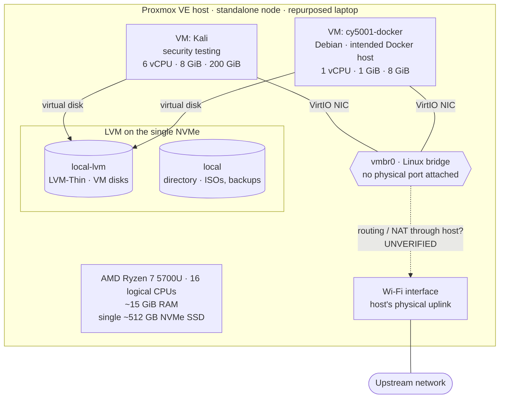

# Homelab

This is the working record of my personal cybersecurity homelab: what I've built, how it's configured, what I've tested, and what I still need to fix.

I run the lab on a repurposed laptop running Proxmox VE. It has two virtual machines: a Kali Linux VM for security work and a Debian VM I set up as a Docker host. I use it to practise the skills I care about most: Linux administration, secure configuration, containerization, network security, and troubleshooting. I want to practise them on infrastructure I'm responsible for, not just read about them.

This repository is meant to grow with the lab. I've tried to be explicit about what I've verified, what I'm inferring, and what is still a plan.

## Why I built it

- **Hands-on infrastructure.** Running a hypervisor, its storage, and its networking myself forces me to understand the decisions behind them.
- **A safe place for security work.** Testing tools and techniques belongs on machines I own and control.
- **Secure deployment practice.** I want to take services from "it runs" to "it's configured deliberately," and document the gap between the two honestly.
- **Troubleshooting.** Things break in a homelab, and figuring out why is most of the learning.

## Technologies in use

| Area | What I actually use |
|---|---|
| Virtualization | Proxmox VE 8.4 (KVM/QEMU), single standalone node |
| Storage | LVM and LVM-Thin on a single NVMe SSD |
| Networking | Linux bridge (`vmbr0`) and a Wi-Fi uplink on the host |
| Guest operating systems | Kali Linux (security testing), Debian (Docker host) |
| Containers | Docker Engine, Docker Hub |
| Web / TLS | Apache HTTP Server (`httpd` image), OpenSSL, `mod_ssl` |

## Architecture overview

This is a sanitized, high-level view based on my inventory snapshot of **October 29, 2026**. Solid lines are relationships I observed in the Proxmox configuration. The **dashed line is unverified**: the bridge has no physical port, so I believe guest traffic is routed or NATed through the host's Wi-Fi interface, but I haven't confirmed that from the host's network configuration yet.

I've intentionally left out IP addressing, management access details, and hardware identifiers. The full walkthrough, including the trade-offs behind each choice, is in the [architecture overview](docs/architecture/overview.md).

## Projects

| Project | Status | Summary |
|---|---|---|
| Proxmox host inventory | Documented | Read-only inventory of the hypervisor, VMs, storage, and networking: [docs/inventory.md](docs/inventory.md) |
| Proxmox host configuration | Documented | Host, compute, storage, VM, and backup configuration, with the reasoning behind each: [infrastructure/proxmox](infrastructure/proxmox/README.md) |
| [Dockerized Apache with HTTPS](projects/apache-https/README.md) | Original completed (educational); reproducible build written, but build and tests not yet run | Apache in Docker with a custom page, a self-signed RSA certificate, and `mod_ssl`. Verified over HTTP and HTTPS, then published as [`hailmogambo9/contapache:2.0`](https://hub.docker.com/r/hailmogambo9/contapache). The case study covers what ended up inside that `docker commit` image and a reproducible, non-root Dockerfile rebuild. |

## What the lab can do today

- Run isolated Kali and Debian VMs on a single Proxmox host.
- Host Docker workloads on the Debian VM. I've run and published an HTTPS-enabled Apache container from it.
- Thin-provision VM storage with plenty of headroom. At the snapshot the thin pool was about 26% used and not overcommitted.

## Known limitations

These are the gaps I observed in the **October 29, 2026 snapshot**. I haven't re-verified them as current conditions. They drive the [roadmap](docs/roadmap.md).

- **No visible backups or snapshots.** No backup jobs, archives, or VM snapshots were configured, and there was no off-host backup target.
- **Single point of failure.** The host OS and every VM disk sit on one NVMe drive.
- **End-of-life hypervisor.** Proxmox VE 8 reached end of life in August 2026 according to the official Proxmox FAQ. The host still runs 8.4.
- **Firewall not enforced.** The datacenter-level firewall was disabled and no rules were defined.
- **No segmentation.** The security-testing VM and the service VM share one flat bridge.
- **Limited guest visibility.** The QEMU guest agent isn't configured, so Proxmox can't report guest IPs or OS details.
- **Tight memory on the Docker VM.** 1 GiB with about 88% in use at the snapshot.
- **Wi-Fi uplink.** This is a laptop, so the only physical uplink I observed is wireless. That shapes how bridging and routing can work.

## Roadmap

In priority order, summarized from [docs/roadmap.md](docs/roadmap.md):

1. Establish reliable backups and test a restore.
2. Plan a supported upgrade path off Proxmox VE 8.
3. Review firewall policy without locking myself out.
4. Verify routing/NAT and segment security-testing VMs from service VMs.
5. Verify guest OS versions and Docker state.
6. Right-size memory for the Docker VM.
7. Enable the QEMU guest agent where appropriate.
8. Clean up the attached installer ISO and a stale shell session.
9. Rebuild the Apache project as a reproducible Dockerfile.
10. Add monitoring, logging, vulnerability scanning, and automation over time.

## Documentation

- [docs/inventory.md](docs/inventory.md): hardware, hypervisor, VM, storage, and network inventory (October 29, 2026 snapshot)
- [docs/architecture/overview.md](docs/architecture/overview.md): topology diagram and design trade-offs
- [docs/networking/overview.md](docs/networking/overview.md): bridge and uplink, the unverified egress path, firewall state at the snapshot, and segmentation plans
- [infrastructure/proxmox/README.md](infrastructure/proxmox/README.md): Proxmox host configuration, storage layout, VMs, and backup and recovery
- [projects/apache-https/README.md](projects/apache-https/README.md): Dockerized Apache HTTPS case study and reproducible build
- [docs/roadmap.md](docs/roadmap.md): prioritized improvements and the reasoning behind each one

## A note on what's published here

This is a public repository, so I keep it sanitized. It contains no private or overlay-VPN IP addresses, MAC addresses, serial numbers, credentials, private keys, or step-by-step management access details. Where something is a historical observation rather than current state, I say so.
