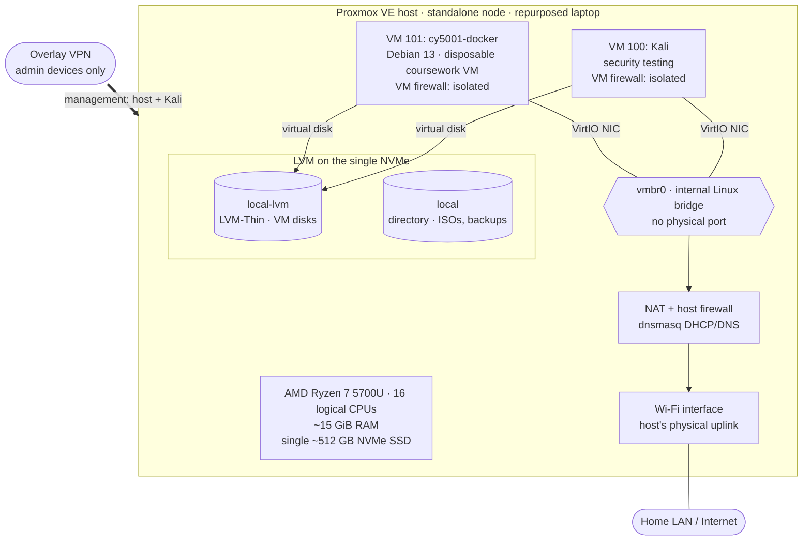

# Homelab

This is the working record of my personal cybersecurity homelab: what I've built, how it's configured, what I've tested, and what I still need to fix.

I run the lab on a repurposed laptop running Proxmox VE. It has two virtual machines: a Kali Linux VM for security work and a disposable Debian VM I use as a Docker host for coursework. I use it to practise the skills I care about most: Linux administration, secure configuration, containerization, network security, and troubleshooting. I want to practise them on infrastructure I'm responsible for, not just read about them.

This repository is meant to grow with the lab. I've tried to be explicit about what I've verified, what I'm inferring, and what is still a plan.

## Why I built it

- **Hands-on infrastructure.** Running a hypervisor, its storage, and its networking myself forces me to understand the decisions behind them.
- **A safe place for security work.** Testing tools and techniques belongs on machines I own and control.
- **Secure deployment practice.** I want to take services from "it runs" to "it's configured deliberately," and document the gap between the two honestly.
- **Troubleshooting.** Things break in a homelab, and figuring out why is most of the learning.

## Technologies in use

| Area | What I actually use |
|---|---|
| Virtualization | Proxmox VE 8.4 (KVM/QEMU), single standalone node |
| Storage | LVM and LVM-Thin on a single NVMe SSD |
| Networking | Internal Linux bridge (`vmbr0`), NAT over the host's Wi-Fi uplink, `dnsmasq` for guest DHCP/DNS |
| Security controls | Proxmox firewall (datacenter + per-VM), `iptables` / conntrack, Tailscale access policies, OpenSSH key-only auth |
| Guest operating systems | Kali Linux (security testing), Debian (Docker host) |
| Containers | Docker Engine, Docker Hub |
| Web / TLS | Apache HTTP Server (`httpd` image), OpenSSL, `mod_ssl` |

## Architecture overview

This is a sanitized, high-level view as of **October 29, 2026**: the dashboard inventory from earlier that day, plus what I verified on the host that evening. Every line in the diagram is verified, including the guest egress path, which earlier versions showed as an unconfirmed hypothesis.

I've intentionally left out IP addressing, management access details, and hardware identifiers. The full walkthrough, including the trade-offs behind each choice, is in the [architecture overview](docs/architecture/overview.md).

## Projects

| Project | Status | Summary |
|---|---|---|
| Proxmox host inventory | Documented | Read-only inventory of the hypervisor, VMs, storage, and networking: [docs/inventory.md](docs/inventory.md) |
| Proxmox host configuration | Documented | Host, compute, storage, VM, firewall, and backup configuration, with the reasoning behind each: [infrastructure/proxmox](infrastructure/proxmox/README.md) |
| [Backups and restore test](docs/backup/2026-10-30-backups-and-restore-test.md) | Completed Oct 30, 2026 (a few follow-ups open) | Offline, ext4-formatted external backup drive; verified backups of both VMs; a Kali restore tested in an isolated VM; email alerts; a backup script. |
| [Access and network hardening](docs/hardening/2026-10-29-access-and-network-hardening.md) | Completed Oct 29, 2026 (a few follow-ups open) | Found that the overlay VPN bypassed the Proxmox firewall and that Kali could reach my home LAN. Locked down remote access, isolated the VMs, made SSH key-only, and debugged a NAT/firewall conntrack issue that broke guest internet access along the way. |
| [Dockerized Apache with HTTPS](projects/apache-https/README.md) | Original completed (educational); reproducible build written, but build and tests not yet run | Apache in Docker with a custom page, a self-signed RSA certificate, and `mod_ssl`. Verified over HTTP and HTTPS, then published as [`hailmogambo9/contapache:2.0`](https://hub.docker.com/r/hailmogambo9/contapache). The case study covers what ended up inside that `docker commit` image and a reproducible, non-root Dockerfile rebuild. |

## What the lab can do today

- Run Kali and Debian VMs on a single Proxmox host, each isolated by its own firewall: internet access, but no path to the host, my home LAN, or each other.
- Manage everything remotely over an overlay VPN restricted to my own devices, with key-only SSH and nothing exposed on the home LAN.
- Spin up disposable Docker VMs for coursework. I've run and published an HTTPS-enabled Apache container from the earlier Docker VM.
- Thin-provision VM storage with plenty of headroom. At the snapshot the thin pool was about 26% used and not overcommitted.

## Known limitations

These are the open gaps as of **October 29, 2026**. They drive the [roadmap](docs/roadmap.md).

- **Backups are weekly, manual and in one location.** Both VMs are backed up to an external SSD that stays offline between runs, and a restore has been tested. But up to a week of changes can be lost, and there's no second copy elsewhere ([backup write-up](docs/backup/2026-10-30-backups-and-restore-test.md)).
- **Single point of failure.** The host OS and every VM disk sit on one NVMe drive.
- **End-of-life hypervisor.** Proxmox VE 8 reached end of life in August 2026 according to the official Proxmox FAQ. The host still runs 8.4. With tested backups now in place, the upgrade is the next priority.
- **Overlay traffic bypasses the host firewall.** The overlay VPN's own firewall chain runs first, so its access policy is the only control on that path. The policy is now an explicit, tested allow-list, but it's a single layer.
- **Some hardening not yet re-verified.** The persisted network rules haven't been through a reboot yet, and the rebuilt Docker VM's firewall rules are in place but haven't been tested from inside the VM yet.
- **Limited guest visibility.** The QEMU guest agent isn't configured, so Proxmox can't report guest IPs or OS details.
- **Wi-Fi uplink.** This is a laptop, so the only physical uplink is wireless. Guests have to be NATed rather than bridged onto the home LAN.

Fixed on October 29, 2026: the firewall is now enforced, the guests are segmented, and remote access and SSH are locked down. See the [hardening write-up](docs/hardening/2026-10-29-access-and-network-hardening.md).

Fixed on October 30, 2026: both VMs have verified backups on an offline drive, a restore has been tested, and Proxmox alerts are delivered by email. See the [backup write-up](docs/backup/2026-10-30-backups-and-restore-test.md).

## Roadmap

In priority order, summarized from [docs/roadmap.md](docs/roadmap.md):

1. ~~Establish reliable backups and test a restore.~~ Done Oct 30, 2026 (host-config backup still open).
2. Plan a supported upgrade path off Proxmox VE 8.
3. ~~Review firewall policy without locking myself out.~~ Done Oct 29, 2026.
4. ~~Verify routing/NAT and segment security-testing VMs from service VMs.~~ Done Oct 29, 2026.
5. Verify guest OS versions and Docker state (in progress).
6. ~~Right-size memory for the Docker VM.~~ Superseded by the rebuild.
7. Enable the QEMU guest agent where appropriate.
8. Clean up the attached installer ISO and a stale shell session.
9. Rebuild the Apache project as a reproducible Dockerfile.
10. Add monitoring, logging, vulnerability scanning, and automation over time.
11. Finish the hardening follow-ups: reboot test, testing VM 101's rules from inside, unused services, drop logging.

## Documentation

- [docs/inventory.md](docs/inventory.md): hardware, hypervisor, VM, storage, and network inventory (October 29, 2026 snapshot)
- [docs/architecture/overview.md](docs/architecture/overview.md): topology diagram and design trade-offs
- [docs/networking/overview.md](docs/networking/overview.md): bridge, NAT and uplink, management access summary, host and per-VM firewall policy, and segmentation decision
- [docs/networking/proxmox-wifi-nat-firewall-conntrack.md](docs/networking/proxmox-wifi-nat-firewall-conntrack.md): case study on Wi-Fi NAT, the per-VM firewall, conntrack zones, and a troubleshooting runbook
- [docs/hardening/2026-10-29-access-and-network-hardening.md](docs/hardening/2026-10-29-access-and-network-hardening.md): findings, fixes, the NAT/conntrack incident, verification results, and lessons learned
- [docs/backup/2026-10-30-backups-and-restore-test.md](docs/backup/2026-10-30-backups-and-restore-test.md): backup target design, first backups, verification, restore test, and email alerts
- [infrastructure/proxmox/README.md](infrastructure/proxmox/README.md): Proxmox host configuration, storage layout, VMs, and backup and recovery
- [projects/apache-https/README.md](projects/apache-https/README.md): Dockerized Apache HTTPS case study and reproducible build
- [docs/roadmap.md](docs/roadmap.md): prioritized improvements and the reasoning behind each one

## A note on what's published here

This is a public repository, so I keep it sanitized. It contains no private or overlay-VPN IP addresses or subnets (other than the internal guest network `10.10.10.0/24`, which is documented deliberately), no MAC addresses, personal device names, serial numbers, credentials, private keys, literal firewall rulesets, or step-by-step management access details. Firewall and access policies are published as summaries of intent. Where something is a historical observation rather than current state, I say so.
