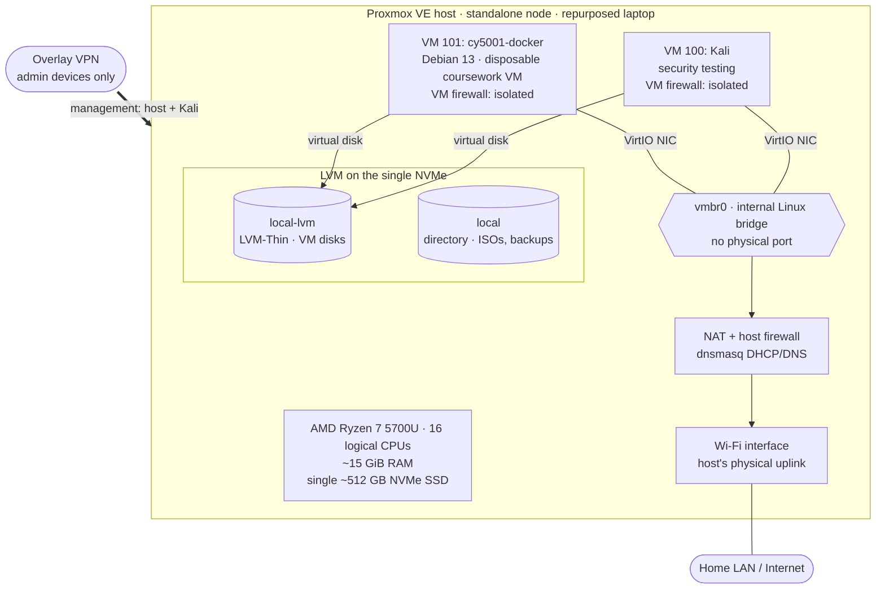

# Architecture Overview

This page describes how the lab fits together and why it's built this way. It's based on the **October 29, 2026 inventory snapshot** ([inventory.md](../inventory.md)), updated with what I verified and changed during the [access and network hardening session](../hardening/2026-10-29-access-and-network-hardening.md) that evening. Where the two differ, I say which is which.

How to read this page:

- **Observed:** shown in the Proxmox dashboard on the snapshot date.
- **Inferred:** my best interpretation of what I observed, not directly confirmed.
- **Unknown:** not visible from the dashboard; needs checking on the host or inside a guest.

I've deliberately left out IP addresses, VPN details, MAC addresses, disk serials, and management access instructions.

## Topology

All lines are relationships I've verified. The guest egress path (bridge → NAT → Wi-Fi) was a hypothesis in the first version of this page; I confirmed it from the host's network configuration on the evening of October 29.

## Components at a glance

| Layer | State (Oct 29, 2026) | Status |
|---|---|---|
| Hardware | Ryzen 7 5700U, 16 logical CPUs, ~15 GiB RAM, one ~512 GB NVMe | Observed |
| Hypervisor | Proxmox VE 8.4.21 on Debian 12, single standalone node | Observed |
| Storage | LVM VG `pve`, LVM-Thin pool for VM disks, directory storage for ISOs/backups | Observed |
| Compute guests | VM 100 `Kali`; VM 101 `cy5001-docker` (rebuilt, minimal Debian 13) | Verified |
| Network | Linux bridge `vmbr0` with no physical port; Wi-Fi as the physical uplink | Observed |
| Guest egress path | IP forwarding + `MASQUERADE` through Wi-Fi; `dnsmasq` for DHCP/DNS | **Verified** |
| Firewall | Datacenter firewall enabled (input DROP, management allow-list); per-VM isolation policies | **Verified** (VM 101 rules present; not yet tested from inside the VM) |
| Remote management | Overlay VPN with an explicit, tested allow-list; SSH key-only | **Verified** |
| Backups | Weekly, manual, to an offline external SSD; verified; restore tested Oct 30 | **Verified** |

## Design decisions and trade-offs

### A single-node hypervisor on a laptop

**What:** One standalone Proxmox node on what appears to be a repurposed laptop. The mobile CPU and the Wi-Fi interface are why I believe it's a laptop. No cluster, HA, Ceph, or replication.

**Why it works for a lab:**

- It reuses hardware I already had.
- It's quiet and low-power.
- A Ryzen 7 5700U with 16 logical CPUs is plenty for a few VMs.
- A laptop has a built-in screen and keyboard. That gives me local console access if remote access breaks, which matters for the upgrade and firewall work on the [roadmap](../roadmap.md).

**What it costs:**

- **No redundancy.** One host, one disk, one network interface. Any hardware fault takes the whole lab down. HA and live migration aren't possible.
- **Laptop constraints.** It has limited RAM and little room for extra internal disks, and the only physical network interface in the inventory is Wi-Fi. Laptop thermals and power management weren't designed for a host that's always on.
- **Single-node simplicity is also a benefit.** There's no quorum or cluster networking to manage, so there's less to break while I'm learning.

This is fine for learning and coursework. It's not a design I'd run anything important on.

### CPU and RAM allocation

**Observed:** Guests were assigned about 7 of 16 logical CPUs (Kali 6, Docker VM 1) and about 9 of ~15 GiB RAM (Kali 8 GiB, Docker VM 1 GiB). Host memory usage was about 72% (10.8 GiB). CPU usage was about 1%, and swap usage was 0%.

**Trade-offs:**

- **CPU isn't overcommitted.** The 7 assigned vCPUs fit within 16 logical CPUs, and load was negligible. There's room for more guests on the CPU side.
- **Memory is the real constraint.** About 15 GiB is usable, and 9 GiB was already assigned. At the snapshot that left roughly 4 GiB free for the host and any new guests. The next VM will be limited by memory, not CPU.
- **The allocation is lopsided.** Kali gets most of the resources, which suits interactive security tooling. The Docker VM got 1 GiB and was at about 88% memory use. That's tight for Docker. Raising it is [roadmap item 6](../roadmap.md#6-right-size-memory-for-vm-101).
- **CPU types differ.** Kali uses Proxmox's default CPU model. The Docker VM uses `host`, which passes the physical CPU's full feature set through. `host` gives the best compatibility and performance but ties a guest to this CPU model. With a single node and no migration, that's a cost I don't pay.

### LVM-Thin storage on a single NVMe

**Observed:** One ~512 GB NVMe holds a GPT layout with EFI and BIOS boot partitions and an LVM physical volume. The `pve` volume group carries the root filesystem (`local` directory storage) and a ~374.5 GB thin pool (`local-lvm`) for VM disks. The thin pool was about 26% used and not overcommitted. 208 GiB of virtual disk was provisioned.

**Why LVM-Thin:** It's the Proxmox installer's default storage layout when ZFS isn't selected. It thin-provisions, so a 200 GiB virtual disk only uses what the guest has written. It also supports snapshots, which Proxmox uses for snapshot-mode backups.

**Trade-offs:**

- **Thin provisioning can overcommit.** It wasn't overcommitted at the snapshot. But if virtual disks are later allowed to exceed the pool and the pool fills up, writes fail for every guest at once. Pool usage needs watching as the lab grows.
- **No ZFS.** ZFS would add checksumming and send/receive replication, but it needs more RAM, and RAM is already the tightest resource. With a single disk it would detect corruption but couldn't repair it.
- **A single disk is a single point of failure.** The hypervisor, both VM disks, and the `local` storage that holds backups all sit on one drive. A backup kept on `local` protects against a bad change, but not against losing the drive.

### VM roles

| VM | Role | Observed / verified | Still unknown |
|---|---|---|---|
| 100 `Kali` | Security-testing workstation | 6 vCPU, 8 GiB, 200 GiB, starts at boot, OS type `Other`. Kernel `7.1.5+kali-amd64` (verified). Firewall flag **on** with an isolation policy since the evening of Oct 29 (it was off at the snapshot). | Installed tooling. |
| 101 `cy5001-docker` | Disposable Docker host for coursework | **Rebuilt** on the evening of Oct 29: minimal Debian 13, no desktop, kernel `6.12.113+deb13-amd64`, firewall flag on, reached via the host as an SSH jump host. 1 vCPU, 2 GiB, 16 GiB (verified Oct 30). (The snapshot showed the original: 1 vCPU, 1 GiB, 8 GiB.) | Docker not yet installed; firewall rules not yet tested from inside the VM. |

**Trade-offs and observations:**

- **Separate VMs per role.** Keeping security tooling apart from service workloads means a messy test environment doesn't contaminate the Docker host. Since the evening of October 29, that separation also holds on the network: per-VM firewalls stop the guests from reaching each other, the host, or the home LAN (see below).
- **Start-at-boot is the opposite of what I'd expect.** The security-testing VM starts automatically and the service VM doesn't. For a lab this may be deliberate, but it's worth reviewing. A testing VM usually doesn't need to run unattended.
- **Legacy virtual hardware.** Both VMs use SeaBIOS and the i440fx machine type, which are Proxmox defaults. They're broadly compatible. OVMF (UEFI) and q35 are the more modern choice and would be needed for features like Secure Boot or a virtual TPM. Changing this on an existing VM isn't a simple toggle, so I'd consider it for new VMs rather than retrofit it.
- **No guest agent.** Without the QEMU guest agent, Proxmox can't report guest IPs, shut guests down cleanly, or freeze filesystems for consistent backups. See [roadmap item 7](../roadmap.md#7-enable-the-qemu-guest-agent).

### A shared bridge with a Wi-Fi uplink

**Observed:** Both VMs attach to `vmbr0`, a Linux bridge with no physical port. It isn't VLAN-aware, and there are no VLANs or SDN zones. The host's physical uplink is a Wi-Fi interface.

**Verified (evening of October 29):** Standard Wi-Fi client connections generally can't be added to a Linux bridge the way a wired NIC can. As I'd expected, `vmbr0` is an internal network on a private /24. The host has IP forwarding on, `MASQUERADE`s guest traffic out over Wi-Fi, and hands out addresses and DNS with `dnsmasq`.

**Trade-offs:**

- **Wi-Fi is convenient but limited.** It needs no cabling. But it's less stable and slower than wired Ethernet, and it rules out simple bridged networking where guests sit directly on the upstream LAN.
- **NAT is a mild security benefit.** Guests aren't directly reachable from the home LAN. But NAT isn't a firewall, and it has a cost: with per-VM firewalls on, NAT needed an extra conntrack-zone rule to work at all ([incident write-up](../hardening/2026-10-29-access-and-network-hardening.md#incident-enabling-the-vm-firewall-broke-internet-access)).
- **One shared bridge, isolated by per-VM firewalls.** The guests still share a layer-2 segment, but each VM's firewall drops traffic to the host (except DNS), other guests, and every private range. I chose this over a separate bridge or VLAN because it was the smaller change on a single Wi-Fi host. The cost is discipline: every new VM needs its own rules, or it's unfiltered.

More detail is in [networking/overview.md](../networking/overview.md).

### Remote management over an overlay VPN

**Verified:** I manage the host and Kali over an overlay VPN (Tailscale) rather than exposing anything on the home LAN. Access is limited to my admin laptop and tablet by an explicit policy that tests itself on every save. SSH is key-only on both machines.

**Trade-off:** the overlay VPN's firewall chain runs before the Proxmox firewall and accepts all overlay traffic. I found that the original allow-all overlay policy let *any* tailnet device, including Kali, reach the hypervisor's management ports. The overlay policy is now the control that matters for that path, so it has to stay correct.

### Backup and recovery gap

**Observed at the snapshot (not verified as current):** no backup jobs, no backup archives, no VM snapshots, no off-host backup target, and no replication.

**Why it matters more here than usual:** With one disk and no recovery points, a disk failure, a bad upgrade, or a mistake inside a guest would be unrecoverable. It also blocks the Proxmox 8 → 9 upgrade, because the official upgrade guide requires a valid, tested backup first.

**Update (October 30, 2026):** both VMs are now backed up to an external SSD that stays offline between runs, and a restore has been tested ([write-up](../backup/2026-10-30-backups-and-restore-test.md)). What's left is a second copy in a different location, and backing up the host configuration.

**Original direction:** Back up to a target that isn't on this NVMe, then prove a restore works. This is [roadmap item 1](../roadmap.md#1-establish-backups-and-test-recovery). The details are in [infrastructure/proxmox/README.md](../../infrastructure/proxmox/README.md#backup-and-recovery).

## What this architecture is and isn't

**It is** a working single-host lab for learning virtualization, Linux administration, containers, and security testing on hardware I control.

**It isn't** production-ready. At the dashboard snapshot earlier on October 29:

- The hypervisor was past end of life.
- The firewall wasn't enforced.
- The network wasn't segmented.
- No backups were visible.

By that evening, the firewall was enforced, the guests were isolated from each other, the host, and the home LAN, and remote access was locked down to an explicit allow-list with key-only SSH ([write-up](../hardening/2026-10-29-access-and-network-hardening.md)). On October 30, verified backups and a tested restore followed. **The end-of-life hypervisor is still open**, and it's the next priority.

I'm documenting these gaps on purpose. Closing them is the point of the [roadmap](../roadmap.md).
