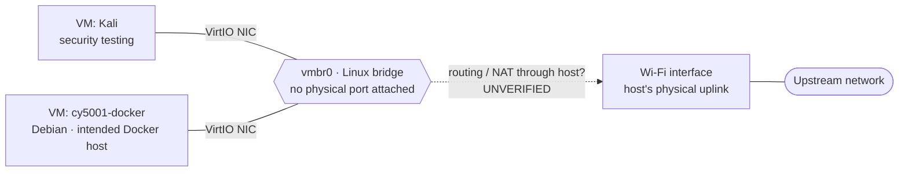

# Networking Overview

This page covers the lab network at a high level. It's based on the **October 29, 2026 inventory snapshot** ([inventory.md](../inventory.md#5-networking)).

For a public repository, I deliberately leave out:

- IP addresses and subnets
- VPN or overlay addresses
- MAC addresses
- interface hardware details
- firewall rulesets
- management access instructions

## Network view

The labels match the [architecture overview](../architecture/overview.md#topology). Solid lines were observed in the Proxmox configuration. **The dashed line is unverified.**

## What I observed

| Item | Snapshot state (Oct 29, 2026) |
|---|---|
| Bridge | `vmbr0`, Linux bridge, active, autostart |
| Bridge ports | None listed |
| VLAN-aware | No |
| VLAN interfaces | None |
| SDN zones / VNets | None (built-in `localnetwork` present, status OK) |
| Physical uplink | One Wi-Fi interface, active, autostart |
| Guest NICs | VM 100 and VM 101 each have a VirtIO NIC on `vmbr0` |

## What I've inferred but not verified

### Guest egress path

`vmbr0` has no physical port, and the host's physical uplink is Wi-Fi.

On Linux, a Wi-Fi interface in normal client mode generally can't be added to a bridge the way a wired NIC can. The access point only expects frames from the client's own address.

So my working hypothesis is:

- `vmbr0` is an internal network.
- The host gives guests outbound connectivity by routing and/or NATing their traffic through the Wi-Fi interface.

**This is unverified.** The dashboard doesn't show IP forwarding, NAT rules, or the bridge's addressing. Other explanations are possible, for example that guests have no outbound connectivity at all, or that something else is configured. I'll confirm it by reading the host's network and packet-filtering configuration. That's read-only, and it's [roadmap item 4](../roadmap.md#4-verify-routingnat-and-segment-the-network).

Until then, the diagrams show this link as dashed.

### Management access

I reached the Proxmox web UI over a private VPN overlay, and that VPN's package repository is configured on the host. That points to VPN-based remote management. But I haven't verified from the host whether the service is running, or whether it does anything beyond giving the host itself a reachable address.

I'm not documenting how management access works in this public repository.

## Unknown

- **Guest addressing and services.** Proxmox can't report them because the QEMU guest agent isn't configured on either VM.
- **Which ports, if any, are reachable from outside the host.** This depends on the unverified routing/NAT setup and on firewall state.
- **The upstream network itself.** Its trust level and other devices are outside the scope of this inventory.

## Firewall (observed October 29, 2026; not verified as current)

At the snapshot:

- **The datacenter firewall was disabled.** Its default policies were input DROP, output ACCEPT, and forward ACCEPT. Those policies weren't being enforced, because the firewall itself was off.
- **No rules were defined** at datacenter or node level.
- **VM firewall flags were mixed.** VM 100 (Kali) was off and VM 101 (Docker) was on. In Proxmox, a VM's firewall flag has no effect while the datacenter firewall is disabled, so I don't expect any Proxmox-level filtering was in effect for either VM. I haven't verified that.

I haven't re-checked these settings since the snapshot. They describe that date only.

There may be other filtering in place, such as host packet-filter rules outside the Proxmox firewall (for example, if NAT is configured) or firewalls inside the guests. The dashboard didn't show any of that, so it's unknown, not absent.

## Trade-offs

| Decision | Benefit | Cost |
|---|---|---|
| Wi-Fi as the uplink | No cabling; uses the laptop's built-in NIC | Less stable and slower than wired; rules out simple bridging of guests onto the upstream LAN |
| Internal bridge with no physical port | Guests aren't directly on the upstream network (if traffic is NATed, which is unverified) | Needs host-side routing/NAT to work; adds a layer to troubleshoot |
| One shared bridge for all VMs | Simple; nothing extra to configure | No separation between the security-testing VM and the service VM |
| Proxmox firewall not enabled (at snapshot) | Can't lock myself out by accident | No Proxmox-level filtering between guests, or between guests and host |

The shared bridge is the trade-off that matters most for a security lab. Kali is a machine I use to run offensive tools, and it sits on the same segment as a service VM with nothing filtering between them. For deliberate testing against my own service that's convenient. But it also means a mistake or misconfiguration on the testing VM isn't contained.

## Planned improvements

These are plans, not completed work. Details are in the [roadmap](../roadmap.md).

1. **Verify the egress path.** Read the host's network configuration and update the diagrams. The dashed edge becomes solid only once it's confirmed.
2. **Segment the network.** Give security-testing traffic its own bridge or VLAN so it can't reach service VMs by default, and decide how the host routes between segments.
3. **Enable the firewall safely.** Define allow rules for the management paths I need first. Test with a local console available as a fallback. Then enable the datacenter firewall, then the node firewall, then per-VM firewalls ([roadmap item 3](../roadmap.md#3-review-firewall-policy-safely)). I'll publish a summary of the policy, not the ruleset.
4. **Enable the guest agent** so guest addresses are visible to Proxmox ([roadmap item 7](../roadmap.md#7-enable-the-qemu-guest-agent)).
