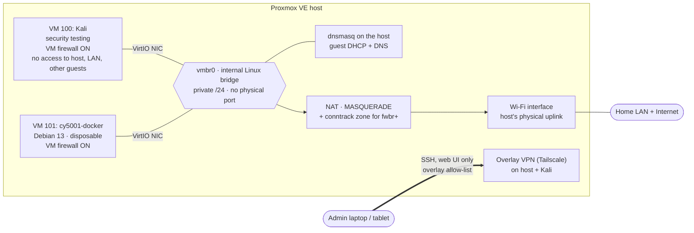

# Networking Overview

This page covers the lab network at a high level. It started from the **October 29, 2026 dashboard snapshot** ([inventory.md](../inventory.md#5-networking)). On the evening of the same day, I read the host's actual network and firewall configuration and hardened it. The details of that session are in the [access and network hardening write-up](../hardening/2026-10-29-access-and-network-hardening.md).

**Case study:** [Proxmox on Wi-Fi, NAT, the VM firewall, and conntrack zones](proxmox-wifi-nat-firewall-conntrack.md). It explains why the guests are NATed rather than bridged, why enabling the per-VM firewall broke guest internet access, how a conntrack-zone rule fixed it, and a troubleshooting runbook.

Labels used below:

- **Verified:** confirmed from command output on the host or in a guest on October 29, 2026.
- **Snapshot:** shown in the Proxmox dashboard earlier that day, and since superseded.
- **Pending:** planned or started, but not yet confirmed.

For a public repository, I deliberately leave out:

- IP addresses and subnets, except the internal guest network (`10.10.10.0/24`, gateway `10.10.10.1`), which is documented in the [case study](proxmox-wifi-nat-firewall-conntrack.md)
- VPN or overlay addresses, device names, and the tailnet name
- MAC addresses
- interface hardware details
- literal firewall rulesets (I publish policy summaries instead)
- step-by-step management access instructions

## Network view

## Addressing and egress (verified)

| Item | Verified state (Oct 29, 2026) |
|---|---|
| Bridge | `vmbr0`, static address on a private /24, `bridge-ports none`, not VLAN-aware |
| Physical uplink | One Wi-Fi interface, DHCP from the home router |
| IP forwarding | Enabled by a `post-up` hook on `vmbr0` |
| NAT | `MASQUERADE` for the guest subnet out through the Wi-Fi interface |
| Conntrack zone | Traffic from Proxmox firewall bridges (`fwbr+`) placed in its own conntrack zone, so NAT works with VM firewalls on ([why](proxmox-wifi-nat-firewall-conntrack.md#9-root-cause-analysis)) |
| Guest DHCP and DNS | `dnsmasq` on the host, bound to the bridge |
| Guest attachments | VM 100 and VM 101 each have a VirtIO NIC on `vmbr0` with the firewall flag on |
| VLANs / SDN | None |

**Why it's built this way:** a Wi-Fi interface in client mode generally can't be added to a Linux bridge the way a wired NIC can, because the access point only expects frames from the client's own address. So instead of bridging guests onto the home LAN, the host keeps them on an internal network and NATs them out. My earlier diagrams showed this as an unverified hypothesis; it's now confirmed from the host's configuration.

The NAT and conntrack rules are applied by `post-up` / `post-down` hooks on `vmbr0`, so they should come back on boot. **Pending:** a deliberate reboot to prove that end to end.

## Management access (summary)

| Path | Policy |
|---|---|
| Overlay VPN → host | Only my admin laptop and tablet, only SSH, web UI, and SPICE proxy. Enforced by the overlay's access policy, which has built-in tests. |
| Overlay VPN → Kali | Only my admin laptop and tablet, only SSH and RDP. |
| Overlay VPN, any other combination | Denied. Kali and the host can't open connections to other overlay devices. |
| Home LAN → host | Management ports dropped by the Proxmox firewall. |
| IPv6 → host | Dropped by the Proxmox firewall (it mirrors the IPv4 rules). |
| Guests → host | DNS (and DHCP) only. |
| VM 101 | No overlay VPN. Reached with SSH through the host as a jump host. |

SSH is key-only everywhere: root on the host can't log in with a password, and Kali has its own dedicated key with passwords disabled.

**Known limitation:** the overlay VPN inserts a firewall chain on the host that accepts all overlay traffic *before* the Proxmox firewall evaluates it. So overlay access is controlled by the overlay policy, not by the host firewall. I've accepted that for now; the reasoning and the option to change it are in the [hardening write-up](../hardening/2026-10-29-access-and-network-hardening.md#residual-risk).

## Firewall (verified October 29, 2026)

### Host

| Item | State |
|---|---|
| Datacenter firewall | Enabled |
| Default policies | Input DROP, output ACCEPT |
| Allowed inbound | Management ports from an allow-list containing only my admin laptop; the overlay VPN's UDP port; DNS and DHCP from the guest bridge |
| Everything else inbound | Dropped |

> The dashboard snapshot earlier on October 29 showed the datacenter firewall **disabled**. By the evening session it was enabled. I don't have a record of exactly when it changed.

### Per-VM policy

Both VMs follow the same isolation pattern. The literal rules stay out of this repository.

| | VM 100 `Kali` | VM 101 `cy5001-docker` |
|---|---|---|
| Firewall flag | On (verified) | On (verified) |
| Inbound default | DROP | DROP |
| Inbound allowed | Overlay VPN UDP; ICMP from the host | SSH from the host only (jump host) |
| Outbound to the host | DNS only | DNS only |
| Outbound to other guests | Blocked | Blocked |
| Outbound to home LAN / private ranges | Blocked (except overlay VPN UDP to LAN peers) | Blocked |
| Outbound to the internet | Allowed | Allowed |
| Status | **Verified** by tests from inside the VM | Rules **verified present** on the host (Oct 30); not yet tested from inside the VM |

**Segmentation decision:** I isolate guests with per-VM firewall rules on the shared bridge instead of creating a second bridge or VLAN. Both approaches stop Kali from reaching the service VM. Per-VM rules were the smaller change on a single Wi-Fi host, didn't need new NAT rules, and are easy to audit per VM. A separate bridge would add a second layer (routing between segments) and is still an option if the lab grows.

## Verification (October 29, 2026)

Tested from inside the Kali VM after the changes:

| Test | Result |
|---|---|
| HTTPS to a public website | `HTTP/2 200` ✅ |
| Host web UI via the bridge | Timed out ✅ |
| Home router | Unreachable ✅ |
| Host web UI via the overlay network | Timed out ✅ |

## Trade-offs

| Decision | Benefit | Cost |
|---|---|---|
| Wi-Fi as the uplink | No cabling; uses the laptop's built-in NIC | Less stable and slower than wired; rules out bridging guests onto the home LAN |
| Internal bridge + NAT | Guests aren't directly reachable from the home LAN | Needs host-side forwarding, NAT, and the conntrack-zone fix; one more layer to troubleshoot |
| Per-VM firewalls on one bridge | Real isolation between guests, host, and LAN without a second network | Every new VM needs its own rules file; forgetting it leaves that VM unfiltered |
| Overlay VPN for management | No management ports exposed to the home LAN or the internet | Its firewall chain bypasses the Proxmox firewall, so the overlay policy has to be right |
| Jump host for the disposable VM | No overlay enrolment or policy change; nothing to clean up afterwards | Depends on the host being reachable; one extra hop |

## Still to do

Details are in the [roadmap](../roadmap.md).

1. **Reboot test.** Confirm guests regain internet after a host reboot.
2. **Test VM 101's firewall rules** from inside the VM (the rules file is confirmed on the host).
3. **Firewall logging.** Turn on drop logging so I can see what's being refused.
4. **Optional:** make the Proxmox firewall filter overlay traffic too, with local console access ready.
5. **Enable the guest agent** so guest addresses are visible to Proxmox ([roadmap item 7](../roadmap.md#7-enable-the-qemu-guest-agent)).
