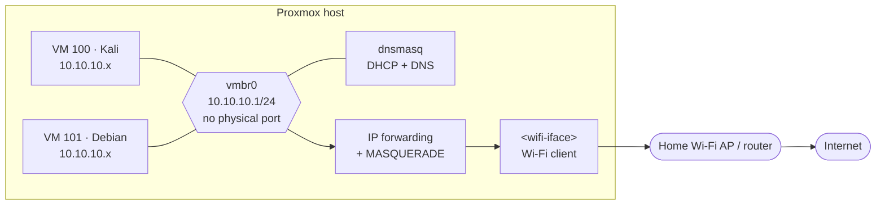
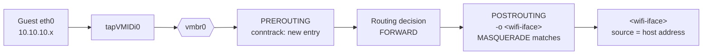
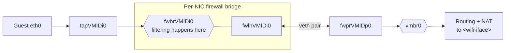
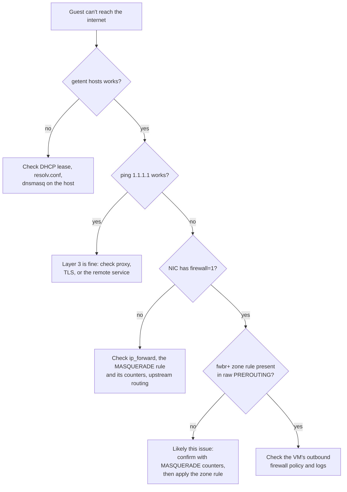

# Case Study: Proxmox on Wi-Fi, NAT, the VM Firewall, and Conntrack Zones

**Date of incident and fix:** October 29, 2026
**Scope:** Proxmox VE 8.4 host on a Wi-Fi uplink, internal guest network `10.10.10.0/24`, iptables `MASQUERADE`, and the per-VM Proxmox firewall
**Related:** [Networking overview](overview.md)

Evidence labels used throughout:

| Label | Meaning |
|---|---|
| **Observed** | Seen directly in command output on the host or in a guest |
| **Reproduced** | Triggered deliberately, and observed to fail and then recover |
| **Documented** | Stated in official Proxmox or netfilter documentation, or by Proxmox developers |
| **Inferred** | A reasonable explanation consistent with the evidence, but not directly proven in this lab |
| **Unknown** | Not checked |

Interface names, MAC addresses, public addresses, and overlay-VPN details are omitted. The host's Wi-Fi interface is written as `<wifi-iface>`.

---

## 1. Executive summary

The Proxmox host reaches the home network over Wi-Fi, so guests can't be bridged directly onto the home LAN. Instead, they live on a private network, `10.10.10.0/24`, and the host routes and NATs their traffic out through the Wi-Fi interface.

That design worked for a VM created **without** the Proxmox firewall option on its network device. A VM created **with** that option couldn't download anything from the internet, even though DNS resolution still worked. During a Debian installation this looked like a broken package mirror.

The failure was **reproduced** on the Kali VM by enabling its firewall option. The VM kept its DHCP lease and DNS, but lost all connectivity through NAT. Proxmox's own documentation describes this case: in masquerading setups with the firewall enabled, outgoing connections can be processed by the VM bridge's `POSTROUTING` path instead of the `MASQUERADE` rule. Its documented fix is to place traffic entering Proxmox firewall bridges in a separate connection-tracking zone:

```text
iptables -t raw -I PREROUTING -i fwbr+ -j CT --zone 1
```

After applying that rule and persisting it in `/etc/network/interfaces`, the firewall-enabled Kali VM regained internet access. A newly created firewall-enabled Debian VM then installed normally from its package mirror.

The VM that originally failed had already been destroyed, so its exact failure can't be proven. The same mechanism is the **likely** cause: that VM had the firewall option enabled, the symptoms match, and the reproduction on Kali matches.

---

## 2. Environment and architecture

| Component | State (October 29, 2026) | Evidence |
|---|---|---|
| Hypervisor | Proxmox VE 8.4.21, single node, kernel 6.8.12-43-pve | Observed |
| Host uplink | One Wi-Fi interface in client mode, DHCP from the home router | Observed |
| Guest bridge | `vmbr0`, address `10.10.10.1/24`, `bridge-ports none` | Observed |
| IP forwarding | `net.ipv4.ip_forward = 1` | Observed |
| NAT | `MASQUERADE` for `10.10.10.0/24` out through `<wifi-iface>` | Observed |
| Guest DHCP and DNS | `dnsmasq` on the host: DNS on `10.10.10.1:53`, DHCP bound to `vmbr0` | Observed |
| Proxmox firewall | Enabled at the datacenter level (input policy DROP) | Observed |
| VM 100 (Kali) | VirtIO NIC on `vmbr0`, firewall option initially **off** | Observed |
| VM 101 (original Docker VM) | VirtIO NIC on `vmbr0`, firewall option **on** | Observed in the dashboard snapshot before it was destroyed |
| Packet filter backend | iptables rules (`PVEFW-*` chains) | Observed |



---

## 3. Why Wi-Fi changes the conventional bridging approach

The standard Proxmox network design adds the physical NIC to a Linux bridge (`vmbr0`) so guests appear directly on the LAN with their own MAC addresses. That works with Ethernet. It generally doesn't work with a Wi-Fi interface in client (station) mode:

- In infrastructure mode, frames between a client and its access point carry three MAC addresses, not four. An access point normally accepts frames only from the MAC address of the client that associated and authenticated with it.
- Frames from a guest carry the guest's MAC address. When those frames are bridged out of the host's Wi-Fi interface, the access point has no association for that address and normally won't deliver them or traffic back to them.
- Four-address (WDS) mode can avoid this, but it needs matching support on the access point, which consumer routers and shared networks usually don't provide.

The practical options on a Wi-Fi host are a **routed** guest network (with or without NAT), proxy ARP, or MAC-address translation at layer 2. This lab uses the simplest option: a routed internal network with NAT. The host is the guests' only router, and the home network sees all guest traffic as coming from the host.

| Approach | Guests on the home LAN | Complexity | Used here |
|---|---|---|---|
| Bridge the Wi-Fi NIC | Would be, but generally fails in client mode | Low on paper | No |
| Routed + NAT (masquerading) | No; hidden behind the host | Low | **Yes** |
| Routed + proxy ARP | Yes, with host-routed addresses | Medium | No |
| Wired Ethernet bridge | Yes | Low, but needs a cable | Not available |

---

## 4. Private subnet, gateway, NAT and DNS

The relevant part of the host's `vmbr0` definition in `/etc/network/interfaces`, as **observed** on October 29, 2026 after the fix (the Wi-Fi interface name is replaced):

```text
auto vmbr0
iface vmbr0 inet static
  address 10.10.10.1/24
  bridge-ports none
  bridge-stp off
  bridge-fd 0
  post-up echo 1 > /proc/sys/net/ipv4/ip_forward
  post-up iptables -t nat -A POSTROUTING -s 10.10.10.0/24 -o <wifi-iface> -j MASQUERADE
  post-down iptables -t nat -D POSTROUTING -s 10.10.10.0/24 -o <wifi-iface> -j MASQUERADE
  post-up   iptables -t raw -I PREROUTING -i fwbr+ -j CT --zone 1
  post-down iptables -t raw -D PREROUTING -i fwbr+ -j CT --zone 1
```

| Function | Provided by | Notes |
|---|---|---|
| Default gateway for guests | Host, `10.10.10.1` on `vmbr0` | Handed out by DHCP |
| Routing between guests and the home LAN | Kernel IP forwarding | Enabled by the first `post-up` line |
| Source NAT | `MASQUERADE` in the `nat` table, `POSTROUTING` chain | Rewrites the guest source address to the host's Wi-Fi address when traffic leaves `<wifi-iface>` |
| DHCP | `dnsmasq`, bound to `vmbr0` | |
| DNS | `dnsmasq` on `10.10.10.1` | Answered **by the host**. No NAT is involved. |
| Conntrack zone for firewall bridges | `raw` table, `PREROUTING` chain | The fix described in section 12. |

### DNS resolution is not connectivity

This difference explains why the incident first looked like a mirror problem.

- **DNS resolution** here is a query from the guest to `10.10.10.1`. It's delivered to a process on the host itself (the host's `INPUT` path). It never leaves the host and never needs NAT.
- **Fetching a package** is a TCP connection from the guest to a server on the internet. It has to be routed out of the host, source-NATed to the host's Wi-Fi address, answered by the remote server, and translated back on the way in.

So a working `getent hosts deb.debian.org` only proves that the guest can reach the host and that the host can resolve names. It says nothing about whether the guest's own traffic can leave the host. A test that actually exercises the forwarded, NATed path is needed, such as `ping` to a public address or an HTTP request.

---

## 5. Normal VM packet flow (firewall option off)

With the firewall option off, the VM's tap device is attached **directly** to `vmbr0`.



1. The guest sends a packet from `10.10.10.x` to a public address, using `10.10.10.1` as its gateway.
2. The packet arrives on `vmbr0` and is routed by the host.
3. Connection tracking creates an entry for the new flow. The NAT decision for the flow is made once, when the first packet passes `nat`/`POSTROUTING`.
4. The outgoing interface is `<wifi-iface>`, so the `MASQUERADE` rule matches. The entry records a source-NAT mapping to the host's address.
5. Replies come back to the host's address, match the conntrack entry, are translated back to `10.10.10.x`, and are forwarded to the guest.

---

## 6. Firewall-enabled VM packet flow

With the firewall option on, Proxmox inserts a per-NIC **firewall bridge** between the VM and `vmbr0`, so it can filter that VM's traffic with iptables.



The traffic now crosses an extra bridge **before** it reaches the routing and NAT stage. For the Proxmox firewall to filter bridged traffic with iptables, the host passes bridged frames through the iptables hooks (bridge netfilter, `net.bridge.bridge-nf-call-iptables`). The value of that setting wasn't captured on the lab host; section 16 shows how to check it. So the first packet of a new flow passes through netfilter's `PREROUTING` and `POSTROUTING` hooks once as **bridged** traffic on the firewall bridge, and again when it's **routed** out of the host.

That double traversal is the root of the problem (section 9).

---

## 7. Proxmox firewall bridge interfaces

| Device | Role | Source |
|---|---|---|
| `tap<VMID>i<N>` | The guest's NIC as seen on the host ("connector port for the guest") | Community forum, answer from a (now retired) Proxmox staff member |
| `fwbr<VMID>i<N>` | Per-NIC firewall bridge, "where the filtering happens" | Same |
| `fwln<VMID>i<N>` / `fwpr<VMID>p<N>` | Two ends of a veth pair connecting the firewall bridge to `vmbr0`. Proxmox staff describe them as the bridge "out" and "in" devices. | Same; the veth-pair detail comes from community replies |

These devices exist only for NICs with the firewall option enabled. On October 29, the Kali VM's NIC initially had the option off, and the host showed only its `tap` device on `vmbr0`.

The exact wiring can be confirmed on any host (read-only):

```bash
ip -br link | grep -E '^(tap|fwbr|fwln|fwpr)'   # which devices exist
bridge link                                      # which bridge each port belongs to
```

Expected layout: the `tap` and `fwln` ports are members of `fwbr…`, and the `fwpr` port is a member of `vmbr0`. This wasn't captured on the lab host during the incident, so it's **documented/typical**, not observed here.

The wildcard `fwbr+` in the fix matches every firewall bridge on the host, including those for VMs created later.

---

## 8. Incident symptoms

### Original Docker VM (destroyed before the investigation)

| Symptom | Evidence |
|---|---|
| Debian installer could resolve the mirror's name | Reported during the original install |
| Package downloads failed; looked like a mirror problem | Reported |
| The VM's NIC had the firewall option enabled | Observed in the dashboard snapshot |
| The VM was destroyed before any host-side diagnosis | Observed |

### Kali VM: reproduction

The Kali VM worked normally with its firewall option off: it had internet access and was reachable over the overlay VPN. On October 29, its NIC firewall option was enabled as part of a hardening change (a per-VM policy with default-deny inbound and internet-only outbound).

| Observation after enabling the firewall option | Evidence |
|---|---|
| Existing SSH session dropped | Observed. Expected when the NIC is re-plugged |
| New SSH connections over the overlay VPN timed out | Observed |
| Interface `UP` with a `10.10.10.x/24` DHCP address | Observed (Proxmox web console) |
| `getent hosts` for a public name: resolved | Observed |
| `ping -c2 1.1.1.1`: 100% packet loss | Observed |
| Overlay VPN client: `unexpected state: NoState` (couldn't reach its control server) | Observed |
| Turning the firewall option off: connectivity restored immediately | Reproduced |

Everything that terminated **on the host** (DHCP, DNS) worked. Everything **forwarded through NAT** failed. The VM's firewall policy explicitly allowed outbound internet traffic, so a filtering rule wasn't the obvious explanation.

---

## 9. Root-cause analysis

### Candidate causes considered

| Hypothesis | Ruled out because |
|---|---|
| Debian mirror outage | The same failure reproduced on Kali for any public destination, including plain ICMP |
| DNS failure | DNS resolved correctly through the host |
| DHCP or addressing failure | The guest had a valid lease, address and default route |
| A VM firewall rule blocking egress | The policy allowed outbound internet traffic; turning the policy off restored service, but so would any problem specific to the firewall bridge |
| Host firewall blocking forwarding | Forwarding worked with the VM option off, under the same host firewall |
| **NAT not applied to traffic from firewall bridges** | **Consistent with every observation, and documented by Proxmox for this exact setup** |

### Documented explanation

Proxmox's network documentation includes this note for masquerading setups:

> In some masquerade setups with firewall enabled, conntrack zones might be needed for outgoing connections. Otherwise the firewall could block outgoing connections since they will prefer the `POSTROUTING` of the VM bridge (and not `MASQUERADE`).

A 2014 discussion on the Proxmox developer mailing list traced the same behaviour with `LOG` rules. A packet passed through `POSTROUTING` twice. On the first pass its output interface was the bridge, so a `MASQUERADE` rule restricted to the uplink interface (`-o <uplink>`) didn't match, and the reporter noted that MASQUERADE "does not trigger at all". With the conntrack-zone rule added, the second pass had the correct output interface and the rule matched. A more recent community thread describes the same symptom on a similar setup: with the NIC firewall on, packets left the uplink with the **private** source address and the `MASQUERADE` counters stayed at zero.

### Applied to this lab (inferred)

1. The guest's first packet crosses `fwbr…` as bridged traffic. Netfilter creates a conntrack entry for the flow, and `nat`/`POSTROUTING` is consulted with the **bridge** as the output interface. `-o <wifi-iface> -j MASQUERADE` doesn't match, so the flow gets no source-NAT mapping.
2. The same packet is then routed towards `<wifi-iface>`. It belongs to a flow conntrack already knows (same tuple, same zone), so the NAT decision isn't made again.
3. The packet leaves the Wi-Fi interface with its private `10.10.10.x` source address. The home router has no route back to `10.10.10.0/24`, so no reply ever arrives.
4. DNS and DHCP are unaffected, because they terminate on the host and never need NAT.

This explanation is **inferred**: it matches the documented behaviour and every observation in section 8. The decisive evidence (`MASQUERADE` packet counters, the conntrack table, or a capture on the Wi-Fi interface during the failure) **wasn't collected** before the fix was applied. Section 16 lists the commands that would confirm it next time.

---

## 10. Conntrack and NAT

Linux connection tracking (`nf_conntrack`) records each flow, identified by its addresses, ports and protocol, in both directions. It's what lets a stateful firewall accept "replies to connections I started" and what makes NAT work.

Key properties that matter here:

- **NAT is decided per connection, not per packet.** The `nat` table is consulted for the **first** packet of a new flow. The resulting mapping is stored in the conntrack entry, and every later packet in that flow (in both directions) is translated from the entry without consulting the `nat` table again.
- **A wrong first decision persists for the flow's lifetime.** If the first packet of a flow passes `POSTROUTING` at a point where the `MASQUERADE` rule doesn't match, the flow gets no NAT mapping, and later packets of that flow keep their original source.
- **Lookups use the flow's tuple and its zone.** Two passes of the same packet through netfilter, with the same tuple and the same zone, map to the same conntrack entry.

---

## 11. Conntrack zones

A conntrack **zone** is a numeric namespace for connection-tracking entries. The iptables `CT` target documentation describes the option:

> Assign this packet to zone *id* and only have lookups done in that zone. … By default, packets have zone 0. This option applies to both directions.

The `CT` target is valid only in the `raw` table, which runs before conntrack processes the packet.

Zones were introduced to let identical tuples coexist when they belong to logically separate contexts. Here, that's the same packet seen first as bridged traffic and then as routed traffic.

The fix puts every packet that **enters through a firewall bridge** into zone 1:

- **Bridged pass (zone 1):** the packet enters through `fwbr…`, so its conntrack entry is created in zone 1. The failed `MASQUERADE` match on this pass only affects that zone-1 entry.
- **Routed pass (zone 0):** when the packet is routed out of the host, it's processed as arriving on `vmbr0`, not `fwbr…`, so it's in the default zone 0. No zone-0 entry exists yet, so a new one is created and the `nat` table is consulted with the correct output interface. `MASQUERADE` matches, and the flow gets its mapping.

---

## 12. The applied fix

**Documented by:** the Proxmox network documentation (masquerading section), added through an official documentation patch in February 2020.

Applied live on the host on October 29, 2026:

```bash
# State-changing. Adds one rule to the raw table.
iptables -t raw -I PREROUTING -i fwbr+ -j CT --zone 1
```

| Part | Meaning |
|---|---|
| `-t raw -I PREROUTING` | Insert at the top of the `raw` table's `PREROUTING` chain, which runs before connection tracking |
| `-i fwbr+` | Match packets whose input interface is any Proxmox firewall bridge |
| `-j CT --zone 1` | Track those packets in conntrack zone 1 instead of the default zone 0 |

The rule doesn't accept, drop or rewrite packets. It only changes which conntrack namespace the matching packets are tracked in. Filtering is still done by the Proxmox firewall rules.

After the rule was added, the Kali VM's firewall option was enabled again. Internet access returned, the overlay VPN client reconnected, and SSH to the VM over the overlay worked again. (A restart of the overlay client had been planned as part of this step; whether it was needed wasn't recorded.)

---

## 13. Persistence through `/etc/network/interfaces`

A rule added with `iptables` is lost at reboot. The fix was persisted next to the existing NAT rules in the `vmbr0` stanza, as shown in section 4:

```text
post-up   iptables -t raw -I PREROUTING -i fwbr+ -j CT --zone 1
post-down iptables -t raw -D PREROUTING -i fwbr+ -j CT --zone 1
```

- `post-up` adds the rule when `vmbr0` comes up, including at boot.
- `post-down` removes it when `vmbr0` goes down, so taking the interface down and up doesn't stack duplicate rules.
- Placing it in the `vmbr0` stanza ties the rule to the same lifecycle as the NAT rule it supports.

**Caveats:**

- `ifreload -a` and similar tools re-run hooks. If a hook runs `post-up` without the matching `post-down` having run, the `-A` / `-I` commands can add **duplicate** rules. Duplicates of these particular rules are harmless, but they make the ruleset confusing. The live fix was applied with `iptables` directly for this reason, rather than by reloading networking.
- **A reboot test hasn't been done yet.** The configuration was inspected after editing (section 4), but persistence at boot hasn't been demonstrated.

---

## 14. Verification and testing

| Test | Result | Evidence |
|---|---|---|
| Firewall option enabled on Kali → `ping 1.1.1.1` | 100% loss | Reproduced |
| Same state → `getent hosts <public name>` | Resolved | Observed |
| Firewall option disabled → connectivity | Restored immediately | Reproduced |
| Zone rule added, firewall option enabled → HTTPS request to a public website from Kali | `HTTP/2 200` | Observed |
| Same state → SSH to Kali over the overlay VPN | Succeeded | Observed |
| Same state → Kali to the host's web UI on `10.10.10.1` | Timed out (blocked by policy, as intended) | Observed |
| Same state → Kali to the home router | Unreachable (blocked by policy, as intended) | Observed |
| New Debian 13 VM created **with** the firewall option, after the fix → installer package downloads | Succeeded; installation completed | Observed |
| `/etc/network/interfaces` contains matching `post-up` / `post-down` zone rules | Present | Observed |

**Not yet verified:**

- Persistence across a host reboot.
- Direct evidence of the mechanism: `MASQUERADE` counters, conntrack entries, or a packet capture on `<wifi-iface>` during the failure.
- That the original Docker VM failed for this reason. It was destroyed before diagnosis, so this remains the **likely** cause, not a confirmed one.

---

## 15. Security considerations

- **Don't "fix" this by turning the VM firewall off.** That does restore connectivity, but it removes the per-VM isolation that stops a security-testing VM from reaching the host, the home LAN and other guests. The zone rule keeps the firewall and restores NAT.
- **The rule doesn't open anything.** It sits in the `raw` table and only selects a conntrack zone. It doesn't add an accept path. The Proxmox firewall's filtering is unchanged.
- **It applies to every firewall-enabled VM.** `fwbr+` is a wildcard, which is the intent here: future VMs with the firewall option work without extra steps. It also means the rule's behaviour should be re-checked when the host's networking changes.
- **Possible side effects on bridge-local traffic.** One community report describes the zone rule restoring internet access but breaking connectivity to another host on the same bridge. That wasn't observed here, and in this lab guests are deliberately blocked from the bridge subnet anyway. But it's worth testing if guest-to-guest or guest-to-host services are ever allowed.
- **Rules outside the Proxmox firewall manager.** The NAT and zone rules are managed by interface hooks, not by `pve-firewall`, so they don't appear in the Proxmox firewall GUI. Anyone auditing the host's packet filtering needs to read `iptables -S` for all tables, not just the GUI.
- **NAT is not a security boundary.** It hides guests from the home LAN, but filtering is done by the Proxmox firewall rules.
- **Upgrade risk.** These rules use iptables. The Proxmox VE 8 → 9 upgrade, or a move to the nftables-based Proxmox firewall, should include re-checking that both the `MASQUERADE` rule and the zone rule are still loaded and effective, and that guest egress still works.

---

## 16. Troubleshooting runbook

Use this for a guest that can resolve names but can't reach the internet. Commands are **read-only** unless marked otherwise.

### Inside the guest

| Command | What it checks |
|---|---|
| `ip -br addr` | Interface is up and has a `10.10.10.x/24` address (DHCP worked) |
| `ip route` | Default route via `10.10.10.1` |
| `cat /etc/resolv.conf` | Which DNS server the guest uses. An overlay VPN client may replace it with its own resolver. |
| `getent hosts deb.debian.org` | DNS resolution only. Doesn't prove internet access. |
| `ping -c2 -W2 1.1.1.1` | Forwarded, NATed layer-3 path to the internet |
| `curl -sSI https://deb.debian.org/` | End-to-end TCP + TLS + HTTP through NAT |

`ping 10.10.10.1` may fail even on a healthy guest if the host firewall drops ICMP from guests, which it does in this lab. Don't use it on its own as a connectivity test.

### On the Proxmox host

| Command | What it checks |
|---|---|
| `qm config <vmid> \| grep ^net` | Whether the NIC has `firewall=1` |
| `ip -br link \| grep -E '^(tap\|fwbr\|fwln\|fwpr)'` | Whether firewall bridge devices exist for the VM |
| `bridge link` | Which bridge each tap/veth port belongs to |
| `sysctl net.ipv4.ip_forward` | Forwarding enabled (`1`) |
| `sysctl net.bridge.bridge-nf-call-iptables` | Whether bridged traffic is passed through iptables (expected `1` on a Proxmox firewall host) |
| `iptables -t nat -S POSTROUTING` | The `MASQUERADE` rule exists, with the right source subnet and output interface |
| `iptables -t nat -L POSTROUTING -n -v` | Packet counters on `MASQUERADE`. **Counters that don't increase while the guest generates traffic are strong evidence of this issue.** |
| `iptables -t raw -S PREROUTING` | Whether the `fwbr+` zone rule is present (and not duplicated) |
| `conntrack -L -s 10.10.10.<x>` | Conntrack entries for the guest, including their zone and whether a source-NAT mapping is present. Needs the `conntrack` package. |
| `tcpdump -ni <wifi-iface> net 10.10.10.0/24` | Whether packets leave the uplink with a **private** source address. Read-only, but it captures live traffic: keep captures short and don't publish them. |
| `pve-firewall status` | Proxmox firewall running and enabled |
| `grep -A12 'iface vmbr0' /etc/network/interfaces` | Persisted NAT and zone hooks |

### State-changing steps (potentially disruptive)

Only use these deliberately, with console access to the guest and host available.

| Command | Effect | Risk |
|---|---|---|
| `qm set <vmid> --net0 <model>=<mac>,bridge=vmbr0,firewall=0\|1` | Toggles the VM firewall option, which re-plugs the NIC | Drops the guest's existing connections; with `firewall=0`, removes per-VM isolation |
| `iptables -t raw -I PREROUTING -i fwbr+ -j CT --zone 1` | Adds the zone rule live | Re-running it adds a duplicate |
| `iptables -t raw -D PREROUTING -i fwbr+ -j CT --zone 1` | Removes the zone rule | Breaks NAT for firewall-enabled VMs again |
| `ifreload -a` / `ifdown vmbr0 && ifup vmbr0` | Re-applies interface configuration | Interrupts all guest networking; can duplicate hook-added rules |
| `systemctl restart <overlay-vpn-service>` (inside the guest) | Restarts the overlay client | Drops overlay sessions to that guest |
| `reboot` (host) | Full persistence test | All guests and remote access go down during the reboot |

### Decision path



---

## 17. Lessons learned

- **Separate "the name resolves" from "the connection works."** In a NAT design where the gateway also provides DNS, DNS success proves almost nothing about egress. The first useful test is a forwarded one.
- **Test layer by layer.** DHCP, DNS, layer-3 egress and application traffic each fail differently. Splitting them narrowed the problem to the NAT path within minutes.
- **A configuration change that "breaks the network" isn't always a bad rule.** The firewall policy was correct. The failure came from how the firewall's extra bridge interacts with NAT and connection tracking.
- **Keep an out-of-band path.** The Proxmox web console reached the guest when its network was down, which made both the diagnosis and the rollback possible.
- **Collect evidence before fixing.** The fix was applied before `MASQUERADE` counters or conntrack entries were captured. The root cause is well documented, but this lab can only call it inferred. Next time, the runbook's evidence steps come first.
- **Don't trade security for connectivity.** Disabling the VM firewall would have "fixed" the symptom. The zone rule fixed the cause and kept the isolation.

---

## 18. References and further reading

### Official Proxmox sources

- [Proxmox VE: Network Configuration](https://pve.proxmox.com/wiki/Network_Configuration), Proxmox VE admin guide. Its masquerading section includes the conntrack-zone note quoted in section 9. (The page itself couldn't be fetched while writing this; its wording was confirmed through the documentation patch below.)
- [pve-devel: "[PATCH v2 docs] network: add note for possible fix/workaround in NAT setup"](https://lists.proxmox.com/pipermail/pve-devel/2020-February/041665.html), Proxmox developer mailing list, February 10, 2020. The official documentation patch that adds the note and the `post-up` / `post-down` lines to the network chapter (`pve-network.adoc`).
- [pve-devel: "pvefw: masquerade problems and conntrack zones"](https://lists.proxmox.com/pipermail/pve-devel/2014-March/010414.html), Proxmox developer mailing list, March 10, 2014. `LOG`-rule traces showing `POSTROUTING` being traversed twice, with `MASQUERADE` matching only after conntrack zones were added.

### Netfilter / iptables

- [iptables `CT` target manual page source (`libxt_CT.man`)](https://git.stg.centos.org/source-git/iptables/blob/c8/f/extensions/libxt_CT.man): a distribution mirror of the upstream iptables man page source. It defines `--zone`, `--zone-orig` and `--zone-reply`, and states that `CT` is valid only in the `raw` table. The same text appears in `man iptables-extensions` on any Linux host.

### Referenced by the Proxmox documentation patch (not independently checked)

- [Netfilter packet flow diagram](https://commons.wikimedia.org/wiki/File:Netfilter-packet-flow.svg) (Wikimedia Commons)
- [LWN: the netdev patch introducing conntrack zones](https://lwn.net/Articles/370152/)

### Community references (not official)

- [Proxmox forum: "Unknown devices (ifconfig)"](https://forum.proxmox.com/threads/unknown-devices-ifconfig.42407/latest): roles of `tap`, `fwbr`, `fwln` and `fwpr` devices, explained by a (now retired) Proxmox staff member, with community follow-ups on the veth pair.
- [Proxmox forum: "VM lost internet connection when firewall on"](https://forum.proxmox.com/threads/vm-lost-internet-connection-when-firewall-on.166012/): the same symptom on a NAT setup. Packets left with the private source address and `MASQUERADE` counters stayed at zero; the zone rule restored egress but was reported to affect another host on the bridge.
