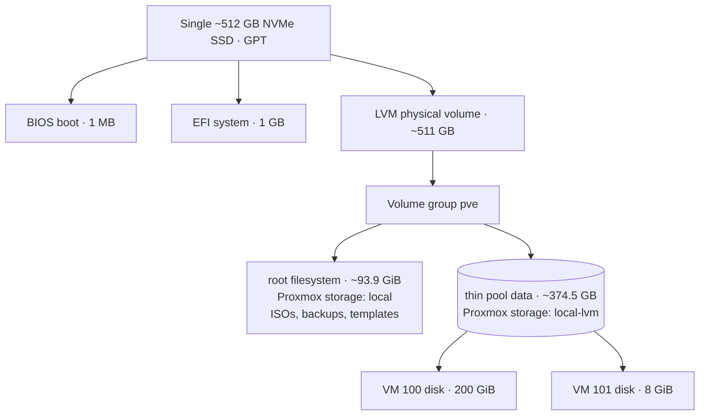

# Proxmox VE Host

This page documents the Proxmox VE host that runs the lab: how it's configured, and the reasoning and trade-offs behind each choice.

Everything here comes from a **read-only inspection of the Proxmox dashboard on October 29, 2026**. The full record is in [inventory.md](../../docs/inventory.md), and the big picture is in the [architecture overview](../../docs/architecture/overview.md).

I didn't change the host or any VM to produce this documentation. Versions, usage figures, and configuration may have changed since the snapshot.

Labels used below:

- **Observed:** shown in the dashboard on the snapshot date.
- **Inferred:** my interpretation, not directly confirmed.
- **Unknown:** needs checking on the host or in a guest.

## Host summary

| Item | Snapshot value (Oct 29, 2026) | Status |
|---|---|---|
| Proxmox VE | 8.4.21 (`pve-manager/8.4.21`) | Observed |
| Kernel | 6.8.12-43-pve | Observed |
| Base OS | Debian 12 Bookworm (from APT suites) | Observed |
| Node | One standalone node, no cluster | Observed |
| HA / Ceph / replication | None | Observed |
| Boot mode | UEFI | Observed |
| Repositories | `pve-no-subscription`, plus Debian main, updates, and security | Observed |
| CPU | AMD Ryzen 7 5700U, 1 socket, 16 logical CPUs | Observed |
| Cores / threads | 8 cores / 16 threads | Inferred (from AMD's specification) |
| RAM | ~14.97 GiB usable, 8 GiB swap (0% used) | Observed |
| Hardware type | Repurposed laptop | Inferred (mobile CPU, Wi-Fi NIC) |

## Lifecycle and version

**Observed:** The dashboard showed a lifecycle warning about Proxmox VE 8.

**Verified against official docs (October 29, 2026):**

- The [Proxmox VE FAQ](https://pve.proxmox.com/wiki/FAQ) lists Proxmox VE 8 (Debian 12) with an end-of-life date of 2026-08. So the installed major version is already past EOL.
- The [Proxmox VE roadmap](https://pve.proxmox.com/wiki/Roadmap) lists Proxmox VE 9.2 (May 21, 2026) as the latest x86-64 release.

**Trade-off:** I'm on the no-subscription repository. That gives me updates without a subscription, but those packages get less testing than the enterprise repository's, which is the usual compromise for a homelab. Being past EOL is a different problem: the Proxmox VE 8 line as a whole is out of support.

**Plan:** Upgrade to Proxmox VE 9, but only after backups exist and have been tested. The prerequisites from the official [8 → 9 upgrade guide](https://pve.proxmox.com/wiki/Upgrade_from_8_to_9) are listed in [roadmap item 2](../../docs/roadmap.md#2-plan-a-supported-proxmox-upgrade). **I haven't upgraded the host.**

## Compute allocation

| | Logical CPUs / vCPUs | RAM |
|---|---|---|
| Host total | 16 | ~15 GiB |
| VM 100 `Kali` | 6 | 8 GiB |
| VM 101 `cy5001-docker` | 1 | 1 GiB |
| **Assigned to guests** | **~7** | **~9 GiB** |

At the snapshot, host memory usage was about 72% (10.8 GiB) and CPU usage was about 1%. KSM sharing was at 0 B.

**Reasoning and trade-offs:**

- **Memory, not CPU, limits growth.** CPU is lightly used and not overcommitted. Memory left only about 4 GiB free at the snapshot, so any new VM needs memory planned for it. I'd also have to take memory from Kali or accept less headroom for the host.
- **I'm not relying on memory overcommit.** KSM at 0 B fits that: there's no meaningful memory deduplication with two dissimilar guests.
- **The Docker VM is undersized.** 1 GiB at about 88% use is tight for Docker. The host has room to give it more ([roadmap item 6](../../docs/roadmap.md#6-right-size-memory-for-vm-101)).

## Storage

**Observed at the snapshot:**

- **Physical disk:** one NVMe SSD (Micron, ~512 GB). SMART status PASSED. The dashboard Wearout column showed 12%. I haven't confirmed exactly what that figure measures (see the [inventory](../../docs/inventory.md#4-storage)).
- **Volume group:** `pve` (~511 GB) with five logical volumes, about 97% allocated, roughly 17 GB free.
- **Thin pool:** `data` (~374.5 GB). About 26% of its data space was used (~98 GB) and about 1% of its metadata. 208 GiB was provisioned to VMs, so it wasn't overcommitted.
- **`local` storage:** directory storage on the root filesystem (~101 GB, about 5% used). It holds one ISO (Debian 13.7 netinst) and no container templates.
- **Not present:** ZFS, Ceph, NFS, SMB, iSCSI, or Proxmox Backup Server.

**Inferred:** The five logical volumes are probably `root`, `swap`, the `data` thin pool, and one thin volume per VM disk. The diagram assumes this layout. I didn't list the volumes individually.

**Trade-offs:**

- **LVM-Thin is a good fit for one disk.** It's the installer default, it thin-provisions, and it supports the snapshots that snapshot-mode backups rely on. It also avoids ZFS's memory overhead on a RAM-constrained host.
- **Thin pools fail badly when full.** If provisioning later exceeds the pool and the pool fills up, every guest's writes fail. Today there's headroom, but I need to watch pool usage, both data and metadata, as I add VMs.
- **Most of the volume group is already allocated.** With about 17 GB unallocated, growing the root filesystem or the thin pool would mean reallocating space, not just using free space.
- **Everything is on one disk.** The OS, the VM disks, and `local` (the default backup location) share a single NVMe. There's no redundancy and no protection against drive failure.

## Virtual machines

Both VMs were running at the snapshot. Neither had snapshots or the QEMU guest agent configured. No LXC containers were present.

| Setting (Oct 29, 2026 snapshot) | VM 100 `Kali` | VM 101 `cy5001-docker` |
|---|---|---|
| Role | Security-testing workstation | Docker host for coursework |
| vCPUs / CPU type | 6 (1 socket × 6 cores) / default | 1 / `host` |
| RAM | 8 GiB | 1 GiB (~88% used) |
| Disk | 200 GiB, `local-lvm`, VirtIO SCSI | 8 GiB, `local-lvm`, VirtIO SCSI, iothread |
| NIC | VirtIO on `vmbr0` | VirtIO on `vmbr0` |
| VM firewall flag | Off | On |
| Start at boot | Yes | No |
| Firmware / machine | SeaBIOS / i440fx | SeaBIOS / i440fx |
| Proxmox OS type | `Other` | Linux 6.x |
| Attached ISO | — | Debian 13 netinst |
| Guest OS | Kali Linux (inferred from name) | Debian (inferred from the ISO); version unknown |

**Unknown:**

- The actual guest OS releases and installed software.
- Whether Docker is currently installed and running on VM 101.
- Whether VM 101 is the same installation I used for the Apache HTTPS project.

**Trade-offs:**

- **VirtIO disks and NICs** are the paravirtualized, best-performing choice for Linux guests.
- **Enabling iothread on VM 101** moves its disk I/O onto a dedicated thread. That's a small, low-risk improvement.
- **SeaBIOS / i440fx** are broadly compatible defaults. OVMF/q35 would be needed for Secure Boot or a virtual TPM. That's a decision for new VMs, not a retrofit.
- **Without the guest agent,** Proxmox can't report guest IPs or do clean shutdowns or filesystem freezes during backup ([roadmap item 7](../../docs/roadmap.md#7-enable-the-qemu-guest-agent)).
- **Start-at-boot looks reversed.** The testing VM starts automatically and the service VM doesn't. I want to review that deliberately rather than leave it as an accident.
- **The VM 101 firewall flag** was on at the snapshot. It has no effect while the datacenter firewall is disabled, which it also was at the snapshot ([networking](../../docs/networking/overview.md#firewall-observed-october-29-2026-not-verified-as-current)).
- **The Debian 13 ISO was still attached** to VM 101 at the snapshot. It's harmless, but it's leftover state worth cleaning up ([roadmap item 8](../../docs/roadmap.md#8-clean-up-the-attached-iso-and-stale-shell-session)).

## Networking

Both VMs share `vmbr0`, a Linux bridge with no physical port. The host's physical uplink is Wi-Fi. I believe guest traffic is routed or NATed through the host, but **that's unverified**.

The networking details, the reasoning behind the hypothesis, and the segmentation plans are in [docs/networking/overview.md](../../docs/networking/overview.md). I keep management access details out of this repository.

## Backup and recovery

**Observed on October 29, 2026 (not verified as current):**

| Recovery mechanism | State at snapshot |
|---|---|
| Scheduled backup jobs | None |
| Backup archives on `local` | None |
| Per-VM backups (100, 101) | None |
| VM snapshots | None |
| Proxmox Backup Server / off-host target | None |
| Replication | None |

At the snapshot there were no recovery points of any kind. Combined with a single disk, that's the most serious risk in the lab. A drive failure, a failed upgrade, or a mistake inside a guest would have had nothing to roll back to.

**Trade-offs I'll need to weigh:**

- **Backups to `local` are easy but don't survive a disk failure.** They protect against bad changes, not drive loss, because they share the NVMe with the VMs.
- **An off-host target** (external drive, network share, or Proxmox Backup Server on separate hardware) protects against drive loss. It adds hardware or network dependencies, and over Wi-Fi, backup throughput may be limited.
- **Snapshots are not backups.** LVM-Thin snapshots live in the same pool on the same disk. They're useful just before a risky change, but they're not a recovery strategy.

**Plan:**

1. Re-check the current backup state.
2. Configure scheduled backups to an off-host target with retention.
3. Back up host configuration too.
4. Test a restore.

This is [roadmap item 1](../../docs/roadmap.md#1-establish-backups-and-test-recovery). It's planned, not done.

## Other observations

- **Stale web shell.** A web shell session started on October 13, 2026 still showed as running in the task log at the snapshot. It's probably stale. I've noted it for review and haven't stopped it.

## Current state, honestly

This host works well as a learning platform. It isn't production-ready or hardened. At the snapshot:

- It was on an end-of-life Proxmox release.
- The Proxmox firewall wasn't enabled.
- The network wasn't segmented.
- No backups were visible.

These gaps are what the [roadmap](../../docs/roadmap.md) is for.
