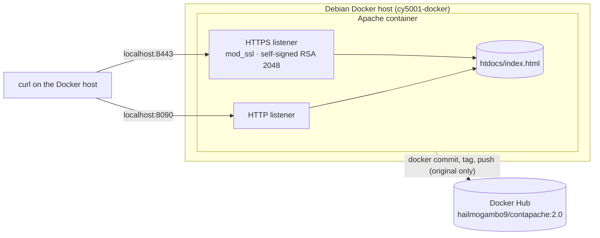

# Dockerized Apache with HTTPS

An educational secure-configuration exercise. I served a custom page from Apache HTTP Server in Docker over both HTTP and HTTPS. HTTPS uses a self-signed RSA certificate. I verified both protocols and published the image to Docker Hub.

This project has **two versions**, and I keep them separate on purpose:

| | Original (historical) | Reproducible build (this directory) |
|---|---|---|
| How it was made | Configured by hand inside a running container, then captured with `docker commit` | `Dockerfile` plus explicit configuration files |
| Published as | [`hailmogambo9/contapache:2.0`](https://hub.docker.com/r/hailmogambo9/contapache) | Not published |
| Status | **Completed and verified** on October 28–29, 2026 (details below) | **Written but not yet built or run.** None of the following has been run: the Docker build, `httpd -t`, the container at runtime, or the smoke test. See [Verification status](#verification-status). |

It's a learning exercise, not a production deployment. Neither version is a hardened, publicly trusted HTTPS service.

## Contents

- [Objective](#objective)
- [Architecture](#architecture)
- [Technologies](#technologies)
- [The original build (historical)](#the-original-build-historical)
- [What is inside the published image](#what-is-inside-the-published-image)
- [The reproducible build](#the-reproducible-build)
- [Build, run, test, and stop](#build-run-test-and-stop)
- [Self-signed certificates and `curl -k`](#self-signed-certificates-and-curl--k)
- [Verification status](#verification-status)
- [Security improvements](#security-improvements)
- [Known limitations](#known-limitations)
- [Lessons learned](#lessons-learned)

## Objective

The goals were to:

- run Apache HTTP Server in a Docker container on my Debian Docker host;
- serve a custom HTML page;
- enable HTTPS with a self-signed RSA certificate using `mod_ssl`;
- verify that HTTP and HTTPS both return the page;
- tag the result and publish it to Docker Hub.

## Architecture



Port mappings:

| Host port | Original container port | Reproducible build container port |
|---|---|---|
| 8090 (HTTP) | 80 | 8080 |
| 8443 (HTTPS) | 443 | 8443 |

The host ports are the same in both versions, so the same `curl` commands work against either. The reproducible build listens on unprivileged ports inside the container, so Apache doesn't need root (see [below](#non-root-execution)).

I ran this on a Debian host named `cy5001-docker`. My [Proxmox inventory](../../docs/inventory.md#vm-101-cy5001-docker) included a VM with the same name. That VM was destroyed and rebuilt on the evening of October 29, 2026, after it lost internet access, so it's no longer possible to confirm from the VM itself whether it was the same installation. The original container and its local image no longer exist; only the published image remains.

## Technologies

- Docker Engine and Docker Hub
- Apache HTTP Server 2.4.69 (official `httpd` image, Debian trixie base)
- `mod_ssl` and `mod_socache_shmcb`
- OpenSSL: RSA 2048 key, X.509 self-signed certificate
- curl, for verification

## The original build (historical)

This is what I did on the Docker host. I'm recording it as it happened. The commands below were run by hand inside the container, and I'm not reproducing the exact command history.

1. **Validated Docker** with `docker run hello-world`.
2. **Started Apache** from the official `httpd` image as a container named `contapache`, mapping host port 8090 to container port 80.
3. **Replaced the default page** at `/usr/local/apache2/htdocs/index.html` with a custom page for my coursework. That page was part of a course submission, so I'm not republishing it here. The reproducible build uses a neutral page instead.
4. **Generated a self-signed certificate** with OpenSSL: a 2048-bit RSA key and a certificate valid for 365 days. Its common name was a course-specific hostname, not `localhost`. (I'm not publishing the certificate's subject or any other certificate contents.) The certificate and key went into `/usr/local/apache2/conf/ssl/`, and I restricted the key's file permissions.
5. **Enabled TLS in Apache.** I uncommented `mod_ssl` and `mod_socache_shmcb` in `httpd.conf` and included `conf/extra/httpd-ssl.conf`. Then I replaced that file with a short virtual host:

   ```apache
   Listen 443

   <VirtualHost _default_:443>
       DocumentRoot "/usr/local/apache2/htdocs"
       ServerName <course-hostname>:443

       SSLEngine on
       SSLCertificateFile "/usr/local/apache2/conf/ssl/apache.crt"
       SSLCertificateKeyFile "/usr/local/apache2/conf/ssl/apache.key"
   </VirtualHost>
   ```

   This is the file from the published image (see the next section), with the hostname replaced by a placeholder. The paths are configuration references, not key material. It doesn't set TLS protocol versions, ciphers, or a session cache, so those were left at `mod_ssl` and OpenSSL defaults.
6. **Validated the configuration.** `httpd -t` returned `Syntax OK`, and `httpd -M` listed `ssl_module`.
7. **Committed and tagged** the container as `hailmogambo9/contapache:2.0`.
8. **Ran the image** with host port 8090 → container port 80, and host port 8443 → container port 443.
9. **Verified both protocols:**
   - `curl -s http://localhost:8090` returned the custom HTML.
   - `curl -ks https://localhost:8443` returned the same HTML.
10. **Pushed to Docker Hub.** The `contapache` repository then showed tag `2.0`.

To pull the published image:

```sh
docker pull hailmogambo9/contapache:2.0
```

### Image size

- **Local:** `docker images` showed about **139 MB**.
- **Docker Hub:** about **59.2 MB**.

These measure different things, so they can't be compared directly. The local figure is the uncompressed size on disk. Docker Hub reports the compressed size of the layers. The Docker Hub API reported 62,084,296 bytes for the `linux/amd64` image on October 29, 2026, which is 59.2 MiB.

### Digest (historical)

> **Unverified.** The digest below was recorded during an earlier review on October 29, 2026. It's well-formed (64 hexadecimal characters), but it hasn't been re-checked against Docker Hub's registry metadata for this documentation: the registry wasn't reachable from the environment used for the review. Don't pin to it until it's been confirmed.

Candidate digest for `hailmogambo9/contapache:2.0` (recorded as a single-platform `linux/amd64` manifest):

```text
sha256:63b896b1e1d4208deca489f06cadcd6883bd6e11344740bf046580e4e35e764c
```

To confirm it, compare it with the digest the registry reports for the tag. Either command is read-only:

```sh
docker buildx imagetools inspect hailmogambo9/contapache:2.0   # "Digest:" line
# or, after a pull:
docker image inspect --format '{{index .RepoDigests 0}}' hailmogambo9/contapache:2.0
```

A tag can be pushed again and then point at a different digest, so any confirmed value describes the tag only as of the date it was checked.

## What is inside the published image

`docker commit` captures whatever changed in the container's filesystem, not just the changes you meant to make. To see exactly what I published, I examined the image's metadata during an earlier review on October 29, 2026. That review read the manifest and configuration from the registry and listed the file names in the committed layer. The sizes and layer counts below come from that review and haven't been re-checked against the registry since. Findings:

- **Base.** The first six layers are byte-identical to the official `httpd:2.4.69` image for `linux/amd64` (Debian trixie). My changes are one extra layer of about 16.8 MB compressed.
- **The published image contained the TLS private key.** At the time I checked, the committed layer included the certificate's private key alongside the certificate. I had restricted the key's file permissions inside the container, but that doesn't make it secret. Permissions only control which users *inside a running container* can read a file. Anyone who pulls the image gets every layer and can read every file in them. The certificate was self-signed for a name I don't own, so the practical impact is low. I still treat that key as public, and I won't reuse it for anything. This document doesn't include the key or the certificate.
- **Most of the layer is leftover package indexes.** About 21 MB (uncompressed) of the layer is APT package-index files from an `apt-get update`. No packages were actually installed in that layer. The image carries them anyway, which explains much of the size difference from the base image.
- **The published image contained root's shell history** (`/root/.bash_history`), recording the commands I typed inside the container. Shell history can include passwords or tokens passed as command arguments. It isn't reproduced anywhere in this repository. A scan of it for possible credentials, reporting only categories and never values, is still pending (see [Known limitations](#known-limitations)).
- **Other leftovers:**
  - a backup copy of the stock SSL config (`httpd-ssl.conf.bak`);
  - a PID file. The official `httpd-foreground` script deletes it at startup, so it's harmless.
- **Port 443 isn't declared.** The image only declares port 80. `-p 8443:443` still works, but the image doesn't document its HTTPS port.
- **Root.** No `USER` is set. As in the official image, the Apache parent process runs as root and the worker processes run as `www-data`.

These findings are the main reason for the reproducible build.

## The reproducible build

| File | Purpose |
|---|---|
| [`Dockerfile`](Dockerfile) | Builds from `httpd:2.4.69`, pinned by digest (the same Apache version and base as the original). Copies in configuration and content, then switches to `USER www-data`. |
| [`conf/httpd.conf`](conf/httpd.conf) | Minimal main config. Loads only the modules it uses, listens on 8080, denies access outside the document root by default, logs to stdout/stderr, and hides version details. |
| [`conf/extra/httpd-ssl.conf`](conf/extra/httpd-ssl.conf) | HTTPS on 8443. TLS 1.2 and 1.3 only, ECDHE ciphers for TLS 1.2, session cache, no session tickets. |
| [`docker-entrypoint.sh`](docker-entrypoint.sh) | At container start, generates a fresh self-signed certificate if none is mounted. |
| [`htdocs/index.html`](htdocs/index.html) | A neutral placeholder page. |
| [`scripts/test.sh`](scripts/test.sh) | Smoke test to run against a running container. |
| [`.dockerignore`](.dockerignore) | Allowlist, so only the files the Dockerfile needs enter the build context. |

### Design decisions

- **No key in the image or the repository.** A key generated at build time would end up in a layer, which is the same problem as the original. Instead, the entrypoint generates a 2048-bit RSA key and a 365-day certificate when a container first starts. They live only in that container's writable layer, and each new container gets a new key. The `.dockerignore` allowlist and the repository's `.gitignore` help keep local certificates out of the build context and out of Git.
- **A certificate that can actually be validated.** The generated certificate has `CN=localhost` and a `subjectAltName` of `DNS:localhost, IP:127.0.0.1`. Modern clients check the SAN, not the CN. With this certificate, a client that trusts it can verify it fully instead of skipping verification. The original certificate's CN didn't match `localhost`, so the original could only be tested with `-k`. See [the next section](#self-signed-certificates-and-curl--k).
- **Explicit TLS policy.** The original left protocol versions and ciphers at their defaults. The new configuration enables only TLS 1.2 and 1.3. For TLS 1.2 it uses ECDHE key exchange with AEAD ciphers, based on Mozilla's "intermediate" profile.
- **A minimal main configuration.** It replaces the stock `httpd.conf`, which loads many modules this site doesn't need. The new config also:
  - denies access to the filesystem by default;
  - disables `.htaccess`, directory indexes and `TRACE`;
  - sends only `Server: Apache` (`ServerTokens Prod`).
- **No HTTP → HTTPS redirect.** HTTP still serves the page so the behaviour matches the original exercise. With a trusted certificate, I'd redirect HTTP to HTTPS and add HSTS instead.

### Non-root execution

The original container's main Apache process ran as root. In the reproducible build:

- the Dockerfile sets `USER www-data`, so no process in the container runs as root;
- Apache binds 8080 and 8443, because ports below 1024 normally need root;
- only `logs/` (PID file, TLS session cache) and `conf/ssl/` (the generated certificate) are writable by `www-data`;
- configuration and content stay root-owned.

One inherited caveat: the official `httpd` image `chown`s the top-level `/usr/local/apache2` directory (not its contents) to `www-data`. The configuration files themselves can't be modified by `www-data`, but owning the parent directory would let it rename `conf/` or `htdocs/` and put replacements in their place, which would take effect on the next start. Running with `--read-only` (below) removes that possibility.

### Assumptions

These come from the base image's published layers, the registry metadata, and my reading of the Apache documentation. None of them has been confirmed by running the build.

- **`openssl` is present.** The `openssl` command exists in `httpd:2.4.69`, at `/usr/bin/openssl` in the base image's layers. The entrypoint uses it.
- **The required modules are present.** `mod_ssl`, `mod_socache_shmcb`, `mod_headers` and `conf/mime.types` all exist in the base image.
- **The `www-data` user exists** in the Debian base image.
- **BuildKit is the builder,** for `COPY --chmod`. BuildKit is the default builder in current Docker Engine releases.
- **Non-root logging (assumed).** I expect Apache, running as `www-data`, to be able to write logs to `/proc/self/fd/1` and `/proc/self/fd/2` when the container is started detached (`-d`, without `-t`). This is untested.
- **The architecture is amd64.** The pinned digest is a multi-architecture index, but I compared it against the original only for `linux/amd64`.
- **The base-image digest is correct.** The `httpd:2.4.69` digest in the `Dockerfile` was taken from Docker Hub on October 29, 2026. It's well-formed, but it wasn't re-checked against the registry for this documentation. If it's wrong, `docker build` fails at the `FROM` line instead of silently using a different image.

## Build, run, test, and stop

Run these on a Docker host, from this directory.

```sh
# Build
docker build -t apache-https:local .

# Run: host 8090 -> HTTP, host 8443 -> HTTPS
docker run -d --name apache-https -p 8090:8080 -p 8443:8443 apache-https:local

# Check the logs (first start shows the certificate being generated)
docker logs apache-https

# HTTP
curl -s http://localhost:8090

# HTTPS with certificate validation: trust this container's own certificate
docker cp apache-https:/usr/local/apache2/conf/ssl/server.crt /tmp/apache-https.crt
curl -s --cacert /tmp/apache-https.crt https://localhost:8443

# Or skip validation, as in the original exercise
curl -ks https://localhost:8443

# Automated smoke test
sh scripts/test.sh apache-https apache-https:local

# Stop and remove
docker stop apache-https
docker rm apache-https
```

`scripts/test.sh` is **designed** to check the following. It **hasn't been run yet**, so none of these checks has passed so far:

- `httpd -t` succeeds inside the container;
- Apache runs as `www-data`;
- HTTP and HTTPS both return the page, with HTTPS validated against the container's certificate;
- HTTPS is rejected when the certificate isn't trusted;
- the `Server` header shows no version;
- a fresh container from the image has no private key.

**Using your own certificate.** Mount a directory containing `server.crt` and `server.key` read-only at `/usr/local/apache2/conf/ssl`. The entrypoint then skips generation. Because Apache runs as `www-data` (UID 33), the key file must be readable by UID 33, for example with `chown 33:33 server.key` and `chmod 600 server.key` on the Docker host.

```sh
docker run -d --name apache-https -p 8090:8080 -p 8443:8443 \
  -v "$PWD/certs:/usr/local/apache2/conf/ssl:ro" apache-https:local
```

The `certs/` directory is ignored by Git.

**Optional tighter runtime settings (untested).** The container needs no Linux capabilities, and it only writes to two directories:

```sh
docker run -d --name apache-https -p 8090:8080 -p 8443:8443 \
  --read-only \
  --tmpfs /usr/local/apache2/logs \
  --tmpfs /usr/local/apache2/conf/ssl \
  --cap-drop ALL --security-opt no-new-privileges \
  apache-https:local
```

## Self-signed certificates and `curl -k`

A **self-signed certificate** is signed by its own key, not by a certificate authority that browsers and operating systems already trust. It still provides an encrypted TLS connection. What it doesn't provide on its own is **authentication**: a client has no built-in reason to believe the certificate belongs to the server it meant to reach.

By default, `curl` rejects a certificate it can't trace back to a trusted authority, and it checks that the certificate matches the hostname. In the original exercise:

- the certificate was self-signed;
- its name (a course-specific hostname) didn't match `localhost`.

Both checks fail, so I used `curl -k` (`--insecure`). That flag skips certificate and hostname verification. It proved that Apache was serving the page over TLS. It didn't prove which server I was talking to. That's acceptable for a local lab test, but `-k` should never become a habit for real endpoints. It's exactly what a man-in-the-middle relies on.

The reproducible build is designed so I can test properly. Its certificate names `localhost` in its SAN, so I can give curl that specific certificate as the only trusted authority (`--cacert`). Then curl can fully verify the server instead of skipping verification, and it still rejects the connection if it doesn't trust the certificate. I've shown this works with the same kind of certificate against OpenSSL's test server (see [Verification status](#verification-status)). I haven't yet shown it against Apache in the container.

For anything beyond a lab, the right fix is a certificate from a trusted CA, for example Let's Encrypt for a public name, or an internal CA whose root is distributed to clients for internal services.

## Verification status

### Original image (historical)

These were run and observed on the Docker host on October 28–29, 2026.

| Check | Result |
|---|---|
| `docker run hello-world` | Succeeded |
| `httpd -t` | `Syntax OK` |
| `httpd -M` includes `ssl_module` | Yes |
| `curl -s http://localhost:8090` | Returned the custom HTML |
| `curl -ks https://localhost:8443` | Returned the same HTML |
| Push to Docker Hub | Succeeded; tag `2.0` listed |

On October 29, 2026, I also read the published image's registry metadata and listed the file names in its committed layer. That's where the image findings above come from. I didn't run or pull the image for this.

### Reproducible build

> **The reproducible build is unverified.** Specifically:
>
> - The new Docker image has **not** been built.
> - `httpd -t` has **not** been run against the new Docker configuration.
> - The new container has **not** been started.
> - The new container smoke tests (`scripts/test.sh`) have **not** been run.
> - The OpenSSL-based checks below were performed independently, outside Docker and without Apache. They do **not** establish that the Docker image builds or works.
>
> Docker wasn't available on the machine where I wrote these files. The fact that the original, hand-built container worked says nothing about this Dockerfile, which uses a different configuration, different ports, and a non-root user.

What I did test locally, without Docker (October 29, 2026, OpenSSL 3.5.7):

| Test | Result |
|---|---|
| Shell syntax check of `docker-entrypoint.sh` and `scripts/test.sh` (`sh -n`) | Passed |
| `docker-entrypoint.sh` run against a scratch directory | Generated `server.crt` and `server.key`, then ran the given command |
| Second run with existing files | Kept the existing certificate (not regenerated) |
| Run with an unwritable certificate directory | Printed the OpenSSL error and exited non-zero without running the command |
| Generated certificate | RSA 2048, `sha256WithRSAEncryption`, valid 365 days, SAN `DNS:localhost, IP:127.0.0.1` |
| `openssl verify -verify_hostname localhost` with the cert as its own trust anchor | OK; fails for a different hostname, as expected |
| TLS handshake against an `openssl s_server` using that certificate and the TLS 1.2 ciphers from `httpd-ssl.conf` | `curl --cacert` succeeded (HTTP 200, verification OK); `curl` without trusting the cert was rejected; `openssl s_client -verify_hostname localhost` returned `Verify return code: 0` over TLS 1.2 with ECDHE-RSA-AES256-GCM-SHA384 |

That handshake test used OpenSSL's test server, not Apache. It shows that the certificate and the validation approach work, not that the Apache configuration does.

**Still to verify on a Docker host:**

1. `docker build` succeeds.
2. `scripts/test.sh` passes: `httpd -t`, non-root, HTTP, verified HTTPS, header, no key in the image.
3. The optional `--read-only` run works.

I'll record the results here with the date once I've run them.

## Security improvements

**Designed into the reproducible build.** None of these has been confirmed by running the container yet:

- **No secrets in image layers.** The key is generated per container at runtime, or mounted. It's never present at build time. The `.dockerignore` allowlist keeps local files out of the build context.
- **Certificate validation instead of `-k`.** The certificate has a correct SAN, and the test validates against it.
- **Non-root execution.** `USER www-data` and unprivileged ports. Only the directories Apache must write to are writable.
- **Smaller attack surface.** Only the needed modules are loaded. There are no directory listings, no `.htaccess`, and no `TRACE`, and the version is hidden.
- **Explicit TLS policy.** TLS 1.2/1.3 only, forward-secret AEAD ciphers for TLS 1.2, and no session tickets.
- **Pinned base image.** The digest pin means a rebuild uses exactly the same base. It also means base-image security fixes only arrive when I deliberately update the pin.
- **No leftovers.** Nothing gets captured by accident, such as package indexes or backup files.

**Not done yet** (these would be next):

- **Image scanning.** Scan the image for known vulnerabilities with a tool such as Trivy or Grype, and keep the base pin current.
- **A smaller base.** An Alpine-based or distroless-style base would reduce image contents further. Trade-off: the entrypoint needs `openssl`, so certificate generation would move outside the image.
- **Runtime hardening by default.** Make `--read-only`, `--cap-drop ALL` and `no-new-privileges` the documented defaults once they're tested. I'd probably use a Compose file.
- **Trusted certificates.** Use a trusted certificate (internal CA or ACME), then redirect HTTP to HTTPS and enable HSTS.
- **The published image.** It still contains the original key and build leftovers. If I republish, it should be a fresh tag built from this Dockerfile.

## Known limitations

- **The new build hasn't been run at all.** That covers the Docker build, `httpd -t`, the container runtime, the smoke test, and the optional hardened run (see [Verification status](#verification-status)).
- **Self-signed only.** It's encrypted, but browsers and clients don't trust it by default.
- **HTTP is still enabled** without a redirect, so the behaviour matches the original exercise.
- **The published `2.0` image** contains its private key, root's shell history, APT package indexes, and a backup config file. It isn't an example to copy. I've left it unchanged on Docker Hub for now; whether to remove or replace it is a separate decision.
- **Shell-history scan pending.** The history in the published image hasn't yet been scanned for credentials. If the scan finds anything credential-like, that credential should be treated as exposed and rotated.
- **Registry digests not re-verified.** Both the published image's digest and the base-image pin come from the October 29 review and haven't been re-checked against the registry since.
- **Not production-ready or fully hardened.** It's a single static page with no monitoring, rate limiting or WAF, and no vulnerability scanning yet.
- **One architecture.** It has only been considered for `linux/amd64`.

## Lessons learned

- **`docker commit` captures everything.** Every file touched in the container went into the image, including a private key, root's shell history, package indexes and a backup file. I only noticed by inspecting the published layers afterwards. A Dockerfile makes every change visible and reviewable.
- **File permissions inside an image don't protect secrets.** `chmod 600` on a key means nothing to someone who can pull the image. Secrets belong at runtime (mounts, secrets managers), not in layers.
- **Image sizes depend on how they're measured.** 139 MB locally and 59.2 MB on Docker Hub are the same image, uncompressed versus compressed.
- **`curl -k` tests encryption, not identity.** Getting a response over HTTPS isn't the same as verifying the server. A certificate with a correct SAN, plus `--cacert`, makes the test meaningful.
- **Defaults are decisions too.** Leaving TLS versions and ciphers unset meant accepting whatever the libraries allowed. Stating the policy explicitly makes it reviewable.
- **Root isn't required.** Moving to unprivileged ports is a small change that removes root from the container entirely.
